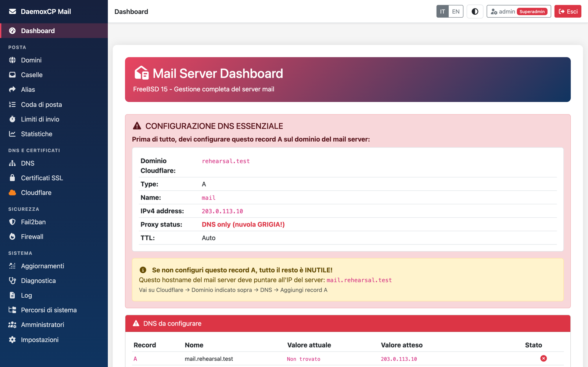
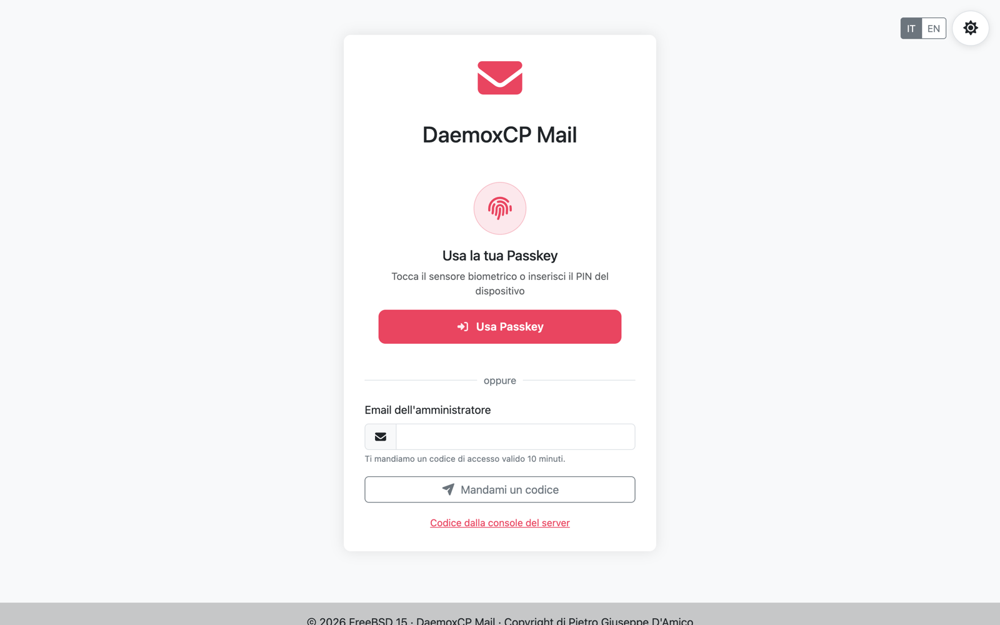
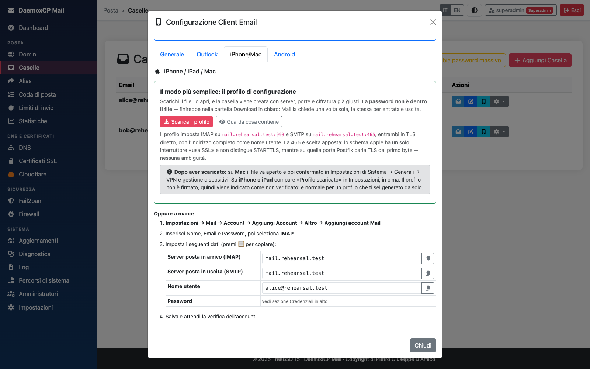
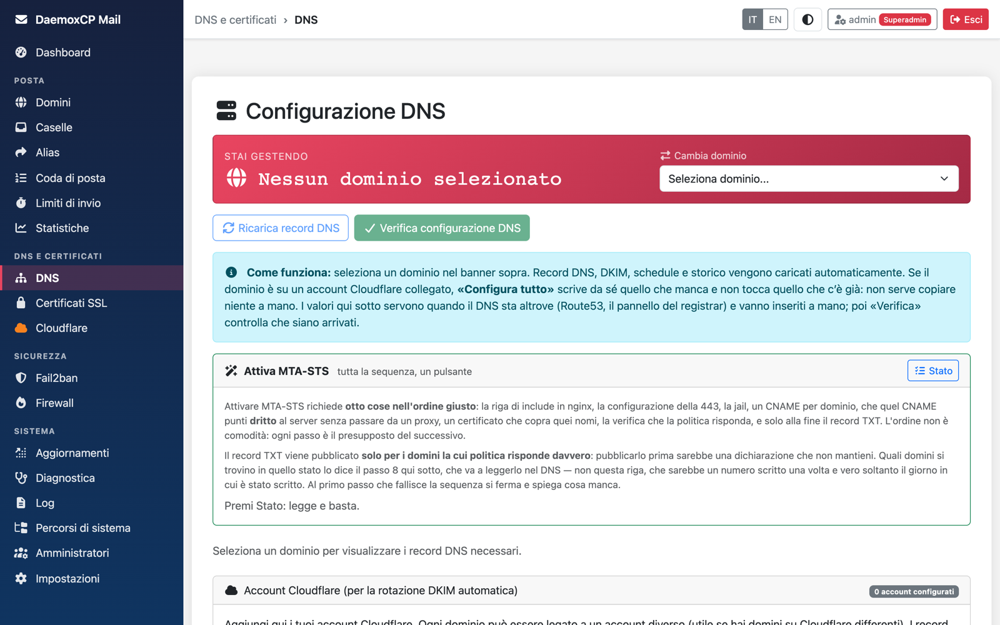
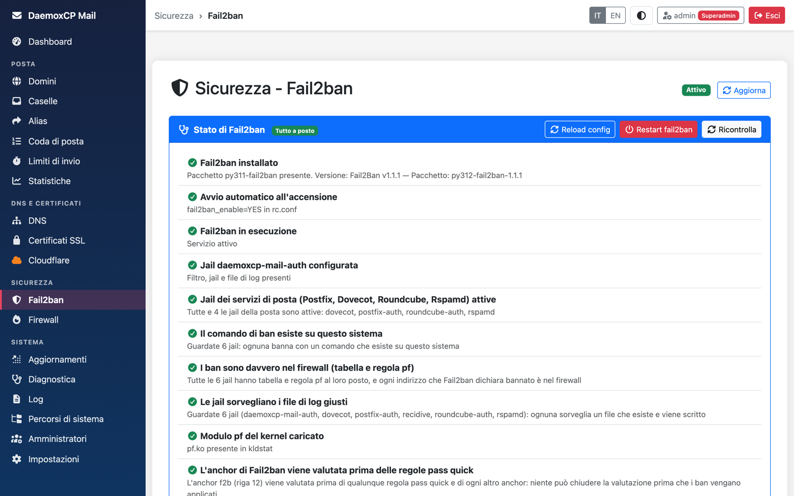
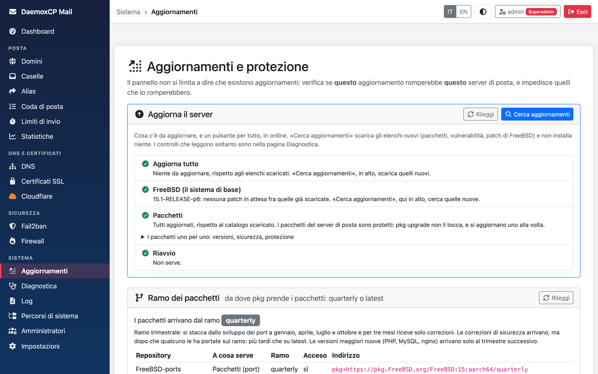
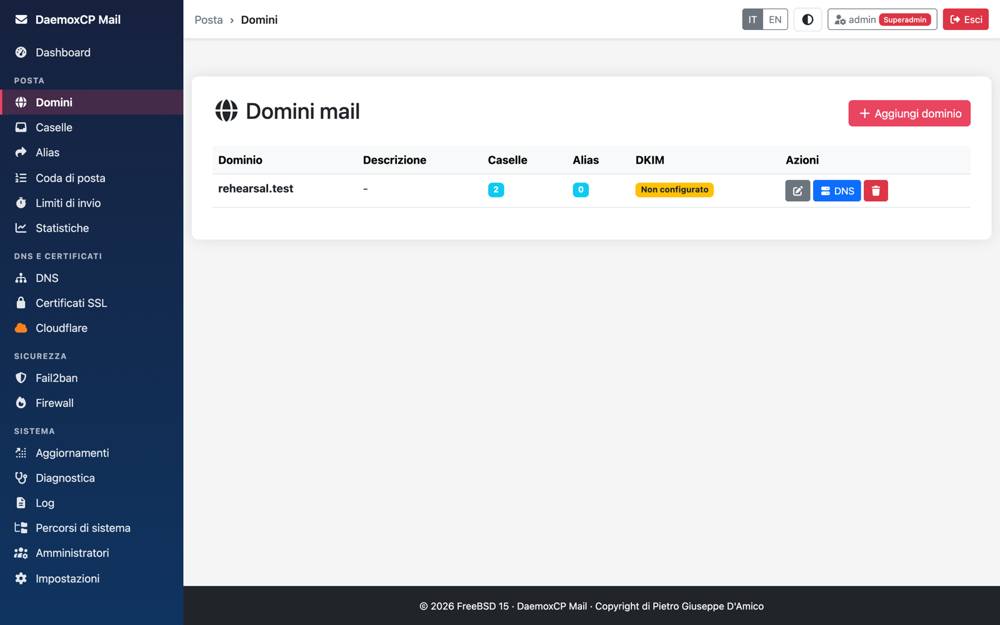
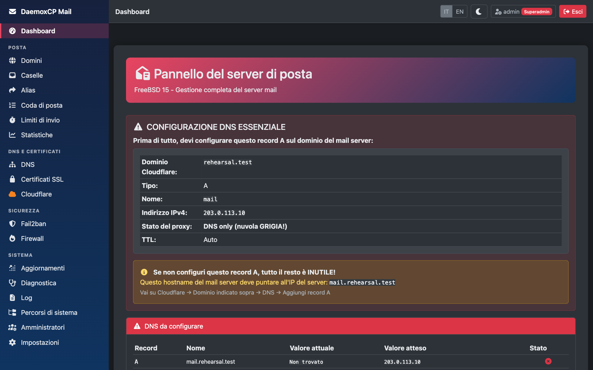
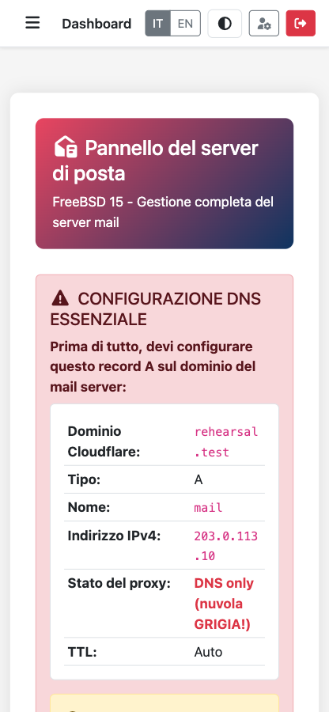

<div align="center">

# 😈 DaemoxCP Mail

**Un server di posta completo e nativo, con il suo pannello di controllo — per FreeBSD.**

Postfix · Dovecot · Rspamd · ClamAV · Redis · MySQL · Roundcube · nginx · fail2ban · pf

`solo FreeBSD 15.0+` · `amd64 / arm64` · `Java 25` · `AGPL-3.0` · `niente Docker, niente strato Linux` · `accesso senza password`

<a href="https://buymeacoffee.com/pietrogdamico"></a>
<a href="https://www.paypal.com/paypalme/pietrogdamico28"></a>

[English](README.md) · **Italiano**



</div>

> [!IMPORTANT]
> **DaemoxCP Mail gira su FreeBSD, e solo su FreeBSD 15.0 o successivo.** È costruito attorno al sistema base di
> FreeBSD: `pkg`, `rc.d`, `pf`, `bectl` e i boot environment ZFS, `freebsd-update`, `newsyslog`, `local-unbound`.
> Non gira su Linux, macOS, altri BSD o FreeBSD 14 e precedenti, e non è previsto che ci giri.

---

## Indice

- [Che cos'è](#che-cosè)
- [Che cosa fa](#che-cosa-fa)
- [Screenshot](#screenshot)
- [Requisiti](#requisiti)
- [I programmi della posta](#i-programmi-della-posta)
- [Sicurezza: chi gira da root, e perché](#sicurezza-chi-gira-da-root-e-perché)
- [Installazione](#installazione)
- [Cosa non c'è ancora](#cosa-non-cè-ancora)
- [L'uso di tutti i giorni](#luso-di-tutti-i-giorni)
- [Tenerlo aggiornato](#tenerlo-aggiornato)
- [Da FreeBSD Mail Panel](#da-freebsd-mail-panel)
- [Riferimento](#riferimento)
- [Se qualcosa non va](#se-qualcosa-non-va)
- [Sostieni il progetto](#sostieni-il-progetto)
- [Autore e licenza](#autore-e-licenza)

---

## Che cos'è

DaemoxCP Mail trasforma un server FreeBSD appena creato in un server di posta completo, e poi lo gestisce da un
pannello web. Installa e configura tutto quello che serve, dal server SMTP alla webmail, con i pacchetti e gli
strumenti di FreeBSD. Poi lo tiene in ordine: record DNS su Cloudflare, certificati, aggiornamenti che non
possono rompere la posta, firewall, ban, diagnostica.

È **nativo**: niente container, niente strato di compatibilità Linux, nessuna copia nascosta di programmi. Ogni
servizio è il pacchetto di FreeBSD, gira sotto `rc.d`, con la configurazione dove FreeBSD se l'aspetta
(`/usr/local/etc`). Un amministratore che conosce FreeBSD non trova niente di strano sulla macchina.

È **prudente**. Il pannello non cambia mai qualcosa che non può controllare, e quando si rifiuta dice perché:

- ogni configurazione che scrive viene provata prima di essere usata (`postfix check`, `doveconf`, `nginx -t`,
  `pfctl -nf`, `fail2ban-client -t`);
- un aggiornamento dei pacchetti della posta viene provato prima di farlo;
- ogni operazione rischiosa tiene una strada per tornare indietro, come boot environment ZFS o come copia del file.

---

## Che cosa fa

**Posta**
- Domini, caselle, alias e inoltri, trasformazioni degli indirizzi.
- Password delle caselle salvate come hash BLF-CRYPT, più una copia cifrata che l'amministratore può mostrare.
  La copia è cifrata con una chiave pubblica: la legge solo la parte root del pannello.
- Filtri Sieve e risposte automatiche, compilati e controllati sul server.
- Coda di posta da guardare e da gestire; la dimensione massima dei messaggi.
- Statistiche da Rspamd: spam, ham e addestramento.
- POP3 a scelta (spento all'inizio).

**DNS e certificati**
- Un pulsante, **Configura tutto**, scrive su Cloudflare i record che servono a ogni dominio:
  - DKIM, SPF e DMARC;
  - MTA-STS (politica, record TXT e certificato);
  - l'autoconfig di Thunderbird e i record SRV.

  Non sovrascrive mai un record che c'è già.
- Chiavi DKIM ruotate tramite l'API di Cloudflare, con un token dedicato e col minimo dei permessi per ogni account.
- Certificati Let's Encrypt con `acme.sh` (il pacchetto di FreeBSD, che gira col suo utente `acme`), con la
  verifica DNS su Cloudflare.
- Profili di configurazione di Apple Mail (Mac, iPhone, iPad) e autoconfig di Thunderbird: i programmi di posta
  si configurano da soli.

**Sicurezza**
- Accesso senza password: **passkey** (WebAuthn), codici monouso via email, o un codice dalla console del server.
- Amministratori con ruoli, e un registro di ogni azione.
- Jail di **fail2ban** per Postfix, Dovecot, Roundcube, Rspamd e il pannello stesso, con ban permanenti e la jail
  recidive.
- Firewall **pf**:
  - tutto chiuso tranne quello che serve;
  - blocco per paese;
  - una scheda che tiene il firewall del fornitore al passo con gli indirizzi di Cloudflare.
- Separazione dei privilegi: la parte che risponde in rete gira con un utente senza privilegi (vedi
  [Sicurezza](#sicurezza-chi-gira-da-root-e-perché)).

**Sistema**
- **Aggiornamenti** di FreeBSD (`freebsd-update`) e dei pacchetti (`pkg`):
  - i pacchetti della posta sono bloccati, così che `pkg upgrade` non li possa rompere;
  - il pannello li aggiorna uno alla volta, con i controlli, e solo dal ramo che scegli (`quarterly` o `latest`).
- **Diagnostica**: *Controlla tutto* legge l'intero server e mette prima ciò che va guardato, ognuno col suo
  passo successivo. Fra i controlli:
  - la porta 25 in uscita;
  - il DNS inverso;
  - ogni servizio e ogni certificato;
  - l'elenco degli indirizzi di Cloudflare.
- Registri, percorsi di sistema, utenti dei servizi, riavvii programmati, rapporti periodici via email.
- Interfaccia in **italiano e inglese**, tema chiaro e scuro, usabile dal telefono.

---

## Screenshot

<table>
<tr>
<td width="50%"><br><sub>Accesso: una passkey, un codice via email, o un codice dalla console del server. Nessuna password.</sub></td>
<td width="50%"><br><sub>Caselle, col profilo di configurazione di Apple Mail.</sub></td>
</tr>
<tr>
<td><br><sub>DNS: un pulsante scrive i record su Cloudflare; MTA-STS nell'ordine giusto.</sub></td>
<td><br><sub>Fail2ban: le jail, i registri che leggono, e i ban davvero in pf.</sub></td>
</tr>
<tr>
<td><br><sub>Aggiornamenti: FreeBSD, pacchetti e riavvio, in ordine, con la protezione.</sub></td>
<td><br><sub>Domini, con caselle, alias e stato del DKIM.</sub></td>
</tr>
<tr>
<td><br><sub>Tema scuro.</sub></td>
<td align="center"><br><sub>Sul telefono.</sub></td>
</tr>
</table>

<sub>Screenshot da un server di prova con domini di prova (`*.test`). Gli indirizzi sono quelli riservati alla
documentazione (`203.0.113.0/24`, `2001:db8::/32`).</sub>

---

## Requisiti

| Cosa | Serve |
|---|---|
| Sistema operativo | **FreeBSD 15.0-RELEASE o successivo**, amd64 o arm64. Nient'altro. |
| File system | **ZFS**, per i boot environment: installazione, aggiornamenti e passaggi del pannello tengono una strada per tornare indietro con `bectl`. |
| Memoria | **4 GB di RAM**. Misurato su un server in uso: ClamAV 1–1,3 GB, i due processi Java del pannello circa 0,5 GB, MySQL 0,1–0,5 GB; 2,5–3 GB in tutto. |
| Disco | almeno 20 GB, più la posta. |
| Rete | un indirizzo IPv4 pubblico (IPv6 è un di più), con un DNS inverso che puoi impostare, e la porta 25 in uscita aperta (molti fornitori la chiudono sugli account nuovi). |
| Accesso | root via SSH con una chiave. **Il pannello non tocca mai la configurazione di SSH.** |
| DNS | i domini di posta su **Cloudflare**, e un token API limitato alle loro zone. |
| Java | OpenJDK 25 (`pkg install openjdk25`). |
| Nomi | tre nomi: uno per la posta, uno per la webmail, uno per il pannello ([dettagli](#cosa-serve-prima-di-cominciare)). |

---

## I programmi della posta

Tutti dai pacchetti di FreeBSD, configurati dal pannello, avviati da `rc.d`.

| Programma | Ruolo | In ascolto su |
|---|---|---|
| **Postfix** | SMTP: riceve la posta (25), la prende dai tuoi programmi (465 TLS, 587 STARTTLS), la spedisce | 25, 465, 587 |
| **Dovecot 2.4** | IMAP (143, 993), POP3 a scelta (110, 995), consegna LMTP, Sieve e ManageSieve | 143, 993, 4190 (solo locale) |
| **Rspamd** | antispam, firma DKIM, greylisting, come milter di Postfix | 127.0.0.1:11332–11334 |
| **ClamAV** | antivirus, tramite Rspamd | socket Unix |
| **Redis** | cache e statistiche di Rspamd | socket Unix |
| **MySQL 8.4** | domini, caselle, alias, i dati del pannello | 127.0.0.1:3306 |
| **nginx + PHP-FPM** | la webmail Roundcube sulla 8443, la politica MTA-STS sulla 443 | 8443, 443, 80 |
| **Roundcube** | webmail, con accesso diretto dal pannello | (dietro nginx) |
| **local-unbound** | il risolutore DNS del server, ricorsivo, perché funzionino le liste DNSBL | 127.0.0.1:53 |
| **fail2ban** | ban dai registri della posta e del pannello, dentro pf | — |
| **pf** | il firewall | — |
| **DaemoxCP Mail** | il pannello | 2096 |

---

## Sicurezza: chi gira da root, e perché

Niente gira da root se non è indispensabile, e dove root resta il pannello dice perché, nella pagina
*Aggiornamenti*, sotto gli utenti dei servizi.

### I processi

Misurati su un server in uso (`ps -ax -o user,command`):

| Servizio | Processo | Utente | Perché |
|---|---|---|---|
| **DaemoxCP Mail** | parte root (`--web`) | `root` | Gestisce la macchina: pacchetti, servizi, firewall, configurazioni, boot environment. **Non apre nessuna porta**: risponde solo alla parte web, su un socket locale. |
| | parte web (`--web-part`) | `daemoxcp_mail` | Tutto ciò che risponde in rete (porta 2096). Quello che chiede root lo passa alla parte root su `/var/run/daemoxcp-mail/root.sock`. |
| **Postfix** | `master` | `root` | Apre le porte della posta e consegna la posta di sistema. |
| | `smtpd`, `qmgr`, `pickup`, … | `postfix` | Tutto ciò che parla con Internet. |
| **Dovecot** | processo principale, `config`, `log`, `anvil` | `root` | Apre le porte IMAP/POP3, avvia ogni accesso e ogni casella con l'utente giusto; con Dovecot 2.4 `anvil` deve raggiungere il processo di ogni sessione per contare e chiudere le connessioni. |
| | `auth` | `dovecot` | Cerca le password. |
| | accessi | `dovenull` | Il lato di rete prima dell'autenticazione. |
| | IMAP, LMTP, caselle | `vmail` | La posta. |
| **nginx** | master | `root` | Apre le porte web e legge le chiavi TLS. |
| | worker | `www` | Servono le richieste. |
| **PHP-FPM** | master | `root` | Non esegue pagine: crea il socket della webmail di `roundcube`, gruppo `www`. |
| | pool `roundcube` | `roundcube` | Le pagine di Roundcube. |
| **fail2ban** | server | `root` | Comanda pf (`/dev/pf` è solo di root) e legge i registri della posta. |
| **Rspamd** | tutti i processi | `rspamd` | |
| **ClamAV** | `clamd`, `freshclam` | `clamav` | |
| **Redis** | `redis-server` | `redis` | |
| **MySQL** | `mysqld` | `mysql` | |
| **local-unbound** | risolutore | `unbound` | |
| **Compilatore Sieve** | `sievec`, quando serve | `sievec` | Compila i filtri degli utenti senza root. |
| **acme.sh** | rinnovi | `acme` | I certificati, senza root. |

### File e permessi

| Percorso | Permessi | Proprietario | Cosa |
|---|---|---|---|
| `/usr/local/etc/daemoxcp-mail/` | `0750` | `root:daemoxcp_mail` | i segreti del pannello |
| `…/root-secrets.properties` | `0600` | `root:wheel` | i segreti della parte root: accesso amministrativo a MySQL, la chiave privata della cassaforte delle password |
| `…/panel-secrets.properties` | `0640` | `root:daemoxcp_mail` | i segreti della parte web, **in sola lettura** per lei: chiavi di cifratura, la sua password di MySQL, la chiave pubblica della cassaforte |
| `…/firewall.json` | `0600` | `root:wheel` | lo stato del firewall |
| `/home/panel/` | `0755` | `root:wheel` | la cartella del pannello |
| `/home/panel/daemoxcp-mail-1.0.jar` | `0644` | `root:wheel` | il programma: la parte web lo legge, solo root lo cambia |
| `/home/panel/database/` | `0750` | `root:daemoxcp_mail` | la configurazione del pannello (SQLite) |
| `/var/run/daemoxcp-mail/root.sock` | `0660` | `root:daemoxcp_mail` | il canale fra le due parti |
| `/var/db/daemoxcp-mail/` | `0755` | `root:wheel` | lo stato del pannello, i registri, i file pubblici di MTA-STS |
| `/var/log/daemoxcp-mail-auth.log` | `0640` | `daemoxcp_mail:wheel` | gli accessi, letti da fail2ban |
| `/var/vmail/` | `0770` | `vmail:vmail` | le caselle (Maildir) |
| `/usr/local/etc/postfix/mysql-*.cf` | `0640` | `root:postfix` | le ricerche di Postfix in MySQL |
| `/usr/local/etc/dovecot/conf.d/auth-sql.conf.ext` | `0600` | `root:dovecot` | la ricerca di Dovecot in MySQL |
| `/usr/local/www/roundcube/config/config.inc.php` | `0640` | `root:roundcube` | la configurazione di Roundcube |
| `/var/run/php-fpm-roundcube.sock` | `0660` | `roundcube:www` | lo usano solo nginx e Roundcube |
| `/var/run/redis/redis.sock` | `0770` | `redis:redis` | Redis, solo per Rspamd |
| `/usr/local/etc/ssl/mail/privkey.pem` | `0600` | `root:wheel` | la chiave del certificato della posta |

### Gli utenti di MySQL

Ognuno può fare esattamente il suo lavoro, e niente di più.

| Utente | Può |
|---|---|
| `daemoxcp_mail` | la parte root del pannello: il database `daemoxcp_mail`. |
| `daemoxcp_mail_web` | la parte web: **solo `EXECUTE`** su un insieme fisso di procedure. Non può leggere né scrivere una tabella direttamente. |
| `daemoxcp_mail_routines` | proprietario di quelle procedure; **bloccato** (`ACCOUNT LOCK`), con una password scritta da nessuna parte. |
| `daemoxcp_mail_postfix` | Postfix: `SELECT` sulle poche colonne che leggono le sue mappe (domini, caselle, alias). |
| `daemoxcp_mail_dovecot` | Dovecot: `SELECT` sulle colonne delle caselle che legge la sua ricerca delle password. |
| `roundcube` | Roundcube: solo il suo database `roundcubemail`. |

### Accesso e dati

- **Nessuna password per gli amministratori.** Si entra con:
  - una **passkey** (WebAuthn, con verifica dell'utente);
  - un **codice di 6 cifre** via email, valido 10 minuti, con 5 tentativi; si salva solo il suo HMAC;
  - un **codice di 8 cifre** dalla console del server.
- **Nessuna enumerazione degli account.** Chiedere un codice dà la stessa risposta che l'indirizzo esista o no.
- **Sessioni.**
  - Stanno in MySQL come SHA-256 del loro token.
  - Il cookie ha il prefisso `__Host-` ed è `Secure`, `HttpOnly`, `SameSite=Strict`.
  - Scadono dopo 30 minuti di inattività e comunque dopo 12 ore, e si possono revocare.
  - Ogni richiesta che cambia qualcosa porta un token CSRF.
- **Le email degli amministratori** sono cifrate con AES-256-GCM e cercate tramite un blind index (HMAC-SHA256).
  Le chiavi stanno fuori dal database.
- **Le password delle caselle** sono salvate come hash BLF-CRYPT, la forma che legge Dovecot. La copia che
  l'amministratore può mostrare è cifrata password per password:
  - con una chiave AES-256-GCM nuova;
  - chiave a sua volta avvolta con RSA-OAEP 3072 nella chiave pubblica della parte root.

  Chi prendesse la parte web non potrebbe leggerle.
- **Le risposte del pannello** portano:
  - una Content-Security-Policy stretta: niente script in linea, ogni file servito dal pannello stesso, nessuna CDN;
  - HSTS, `nosniff`, `frame-ancestors 'none'`.
- Il pannello risponde **solo al suo nome**: raggiunto con l'indirizzo IP o con un altro nome risponde
  `421 Misdirected Request`.

### Rete

- **pf**: in ingresso tutto chiuso tranne SSH, le porte della posta e quelle web (dietro Cloudflare). Il pannello
  non scrive mai una regola su SSH e non lo sposta mai.
- **Cloudflare**: il pannello (2096) e la webmail (8443) si raggiungono attraverso il proxy di Cloudflare. La
  pagina *Firewall* tiene la regola del firewall del fornitore limitata agli indirizzi di Cloudflare.
- **fail2ban** legge, insieme ai registri della posta, il registro degli accessi del pannello,
  `/var/log/daemoxcp-mail-auth.log`.

---

## Installazione

Tutta l'installazione, da un server FreeBSD appena creato a un server di posta il cui pannello torna da solo dopo
un riavvio. Fai i passi in quest'ordine: ognuno si appoggia ai precedenti. Gli esempi usano `example.com`,
`203.0.113.10` e `2001:db8::10`: al loro posto metti i tuoi nomi e i tuoi indirizzi.

### Cosa serve prima di cominciare

- **Un server** con FreeBSD 15.0 o successivo (amd64 o arm64) su **ZFS**, un indirizzo IPv4 pubblico (IPv6 è un
  di più), **4 GB di RAM** e almeno 20 GB di disco.
- **Accesso root via SSH con una chiave.**
- **I tuoi domini su Cloudflare** (il loro DNS è gestito da Cloudflare).
- **Tre nomi**, ognuno con un ruolo preciso:

  | Nome (esempio) | Che cos'è | In Cloudflare |
  |---|---|---|
  | `mail.example.com` | il server di posta: MX, SMTP, IMAP, il DNS inverso del server | **Solo DNS** (nuvola grigia) |
  | `webmail.example.com` | la webmail (Roundcube), sulla porta **8443** | **Proxy** (nuvola arancione) |
  | `panel.example.com` | questo pannello, sulla porta **2096** | **Proxy** (nuvola arancione) |

  Webmail e pannello hanno due nomi perché ognuno ha il suo certificato, la sua configurazione nel menu (opzioni
  3 e 2) e la sua porta. Possono stare nello stesso dominio o in due domini, purché entrambi su Cloudflare. Il nome
  della posta deve essere diverso da tutti e due: la posta (25, 465, 587, 993) non passa dal proxy di Cloudflare,
  i due nomi web sì. Cloudflare fa da proxy HTTPS sulle porte 443, 2053, 2083, 2087, **2096** e **8443**: per
  questo pannello e webmail usano quelle due.

### Passo 1 — Dal fornitore (esempio: Hetzner Cloud)

1. **DNS inverso.** Imposta il DNS inverso (PTR) dell'indirizzo IPv4 del server, e di quello IPv6 se lo usi, al
   nome della posta (`mail.example.com`). Su Hetzner Cloud: il server, *Networking*, il pulsante di modifica
   accanto all'indirizzo. I grandi fornitori di posta rifiutano, o mettono nello spam, la posta da un indirizzo
   il cui DNS inverso non corrisponde.
2. **Porte 25 e 465 in uscita.** Molti fornitori le chiudono sugli account nuovi. Hetzner Cloud le chiude tutte e
   due e le apre su richiesta dopo il pagamento della prima fattura: apri una richiesta al supporto dicendo che il
   server è un server di posta. La posta in arrivo funziona anche senza; quella in uscita resta in coda. Il
   pannello lo controlla per te: *Diagnostica*, *Controlla tutto*, «Posta in uscita (porta 25)».
3. **Il firewall del fornitore.** Crea un firewall con queste regole **in ingresso** e collegalo al server.
   L'uscita lasciala com'è.

   | Regola | Protocollo | Porte | Origini |
   |---|---|---|---|
   | SSH | TCP | 22 (o la porta del tuo sshd) | **solo il tuo indirizzo IP**: il tuo IPv4 come `/32` e, se ce l'hai, il tuo IPv6 come `/128` |
   | Posta | TCP | 25, 80, 143, 443, 465, 587, 993 | qualsiasi IPv4, qualsiasi IPv6 |
   | POP3, solo se lo accendi poi in *Impostazioni* | TCP | 110, 995 | qualsiasi IPv4, qualsiasi IPv6 |
   | Pannello e webmail | TCP | 2096, 8443 | **solo gli indirizzi di Cloudflare** |

   Gli indirizzi di Cloudflare sono pubblicati su <https://www.cloudflare.com/ips-v4> e
   <https://www.cloudflare.com/ips-v6>. Col pannello acceso, la sua pagina *Firewall* ha la scheda «Il firewall
   del tuo provider» con l'elenco pronto da incollare e le stesse regole calcolate dalle porte vere del server.

   Non serve nessun'altra regola in ingresso: in particolare **nessuna per la 53 (DNS) e nessuna per la 123
   (NTP)**. Il firewall di Hetzner Cloud tiene lo stato, quindi le risposte alle domande del server rientrano da
   sole, e una 123 aperta esporrebbe soltanto il servizio dell'orologio.

   **L'elenco di Cloudflare cambia ogni tanto, e lo aggiorni tu.** I token di Hetzner Cloud sono «Read» o
   «Read & Write» su tutto il progetto: un token che può cambiare il firewall può anche cancellare il server, e su
   un server di posta non ci deve stare. Quando hai messo l'elenco nel firewall premi «Ho messo questa lista nel
   firewall del mio provider»: quando Cloudflare cambia il suo elenco, la scheda e la *Diagnostica* te lo dicono.

   Altri fornitori: le stesse regole nel loro firewall. I server dedicati di Hetzner (Robot) hanno un firewall che
   **non** tiene lo stato: lì serve anche la regola che fa rientrare le risposte alle connessioni del server (TCP,
   porte 32768–65535, col flag ACK).

### Passo 2 — Su Cloudflare

1. **Record DNS** (in ogni zona):

   | Tipo | Nome | Contenuto | Stato del proxy |
   |---|---|---|---|
   | A | `mail` | `203.0.113.10` (l'IPv4 del server) | **Solo DNS** |
   | AAAA | `mail` | `2001:db8::10`, se il server ha IPv6 | **Solo DNS** |
   | MX | `@` | `mail.example.com`, priorità 10 | — |
   | A | `webmail` | `203.0.113.10` | **Proxy** |
   | A | `panel` | `203.0.113.10` | **Proxy** |

   Ripeti il record MX in ogni dominio di cui questo server riceve la posta. SPF, DKIM, DMARC, MTA-STS, autoconfig
   e i record SRV li scrive dopo il pannello stesso (passo 7): non li scrivi tu.
2. **Modalità di cifratura SSL/TLS: Full (strict).** Cloudflare parla al server in HTTPS e ne controlla il
   certificato.
3. **Certificati d'origine.** *SSL/TLS*, *Origin Server*, *Create Certificate*: tipo di chiave RSA (2048), i nomi
   (per esempio `panel.example.com` e `webmail.example.com`, oppure `*.example.com` ed `example.com`), validità fino
   a 15 anni. Cloudflare mostra certificato e chiave privata una volta sola: salvali in due file, per esempio
   `panel-origin.pem` e `panel-origin.key`. Un certificato d'origine copre i nomi di una sola zona: se pannello e
   webmail stanno in due domini, creane uno in ciascuno.
4. **Un token API per il pannello.** *My Profile*, *API Tokens*, *Create Token*, modello *Edit zone DNS*, con
   **Zone › DNS › Edit** e **Zone › Zone › Read**, e in *Zone Resources* › *Include* › *Specific zone* ogni dominio
   di posta. Mai la Global API Key. Lo inserisci nel pannello al passo 7.

### Passo 3 — Il sistema base

Entra come root e aggiorna sistema e catalogo dei pacchetti:

```bash
freebsd-update fetch install
```

```bash
pkg update && pkg upgrade
```

La prima volta `pkg` si offre di installarsi: rispondi sì. `freebsd-update` tiene il sistema com'era in un boot
environment (`bectl list` lo mostra) e può riavviare `sshd`: la sessione SSH in cui sei resta aperta. Se ha
installato un kernel nuovo, riavvia (`shutdown -r now`) prima di andare avanti.

### Passo 4 — Java

Il pannello è un programma Java 25:

```bash
pkg install openjdk25
```

OpenJDK su FreeBSD vuole `procfs` montato su `/proc`. Aggiungilo a `/etc/fstab`, così c'è anche dopo ogni riavvio,
e montalo adesso:

```bash
grep -q '^proc' /etc/fstab || echo 'proc /proc procfs rw 0 0' >> /etc/fstab
```

```bash
mount /proc && java -version
```

`java -version` deve dire `25`.

### Passo 5 — Il pannello e i certificati sul server

1. **Costruisci il jar del pannello**, su un qualsiasi computer con Java 25 e Maven, da questo repository:

   ```bash
   tools/build-jar.sh
   ```

   Scrive `target/daemoxcp-mail-1.0.jar` col numero di build e il commit dentro, e stampa lo SHA-256 del jar.
2. **Mettilo in `/home/panel`**, non in `/root`. La parte web del pannello gira col suo utente, `daemoxcp_mail`,
   che deve poter leggere il jar; `/root` è chiusa agli altri utenti.

   ```bash
   install -d -m 755 /home/panel
   ```

   Poi, dal tuo computer:

   ```bash
   scp target/daemoxcp-mail-1.0.jar root@203.0.113.10:/home/panel/
   ```
3. **Copia i certificati d'origine.** La coppia del pannello può stare dove vuoi: il pannello la legge una volta e
   se la tiene. Quella della webmail deve restare dove la metti, perché nginx la legge da lì: usa
   `/usr/local/etc/ssl/webmail/`, mai `/usr/local/etc/ssl/mail/`, che l'installazione svuota.

   ```bash
   install -d -m 700 /root/certs /usr/local/etc/ssl/webmail
   ```

   Dal tuo computer:

   ```bash
   scp panel-origin.pem panel-origin.key root@203.0.113.10:/root/certs/
   ```

   ```bash
   scp webmail-origin.pem webmail-origin.key root@203.0.113.10:/usr/local/etc/ssl/webmail/
   ```

   Sul server, le chiavi private leggibili solo da root:

   ```bash
   chmod 600 /root/certs/*.key /usr/local/etc/ssl/webmail/*.key
   ```

### Passo 6 — Il menu nel terminale

Apri il menu dalla cartella del pannello, in un terminale di almeno 120 × 40 caratteri (dal tuo computer:
`ssh -t root@203.0.113.10`):

```bash
cd /home/panel && java -jar daemoxcp-mail-1.0.jar
```

Frecce per muoverti, Invio per scegliere, Tab per passare da un campo al successivo. Ogni opzione chiede prima una
conferma, con *Cancel* selezionato: premi Tab per arrivare a *OK*. Il menu è in inglese. Segui le opzioni in
quest'ordine:

1. **1) Time zone, clock (NTP) and DNS resolver.** Scrivi il fuso orario del server come nome IANA (per esempio
   `Europe/Rome` o `UTC`): i nomi che non esistono vengono rifiutati. Accende anche NTP.
2. **2) Edit Panel Configuration.**
   - *PANEL PORT*: `2096`;
   - *PANEL HOST*: il nome del pannello, `panel.example.com` (non un indirizzo IP: passkey e Cloudflare vogliono un
     nome);
   - *SSL CERTIFICATE* e *SSL PRIVATE KEY*: `/root/certs/panel-origin.pem` e `/root/certs/panel-origin.key`
     (funziona anche incollare il testo PEM).

   Prima di salvare il pannello controlla che il certificato si legga, sia valido adesso, copra il nome del
   pannello e che la chiave sia la sua, e mostra cosa copre e quando scade.
3. **3) Edit Roundcube Configuration.** *DOMAIN* `webmail.example.com`, *PORT* `8443`, *SSL CERT PATH* e
   *SSL KEY PATH* `/usr/local/etc/ssl/webmail/webmail-origin.pem` e `…/webmail-origin.key`. Stessi controlli.
4. **4) Install/Reinstall Mail Server.** Chiede il nome della posta, `mail.example.com`, controlla i tre nomi, poi
   installa e configura MySQL, Postfix, Dovecot, Rspamd, ClamAV, Redis, nginx, PHP e Roundcube, fail2ban e il
   firewall. Ci vogliono alcuni minuti e va avanti anche se il terminale si chiude; il suo registro è in
   `/var/log/daemoxcp-mail/`. Prima di cominciare tiene il server com'era in un boot environment. **Cancella ogni
   configurazione di posta, casella e account del pannello già presente**: su un server nuovo non c'è niente da
   perdere.
5. **5) Emergency access code.** Non c'è ancora un amministratore: chiede un nome e un'email, crea il primo
   amministratore e mostra un **codice di 8 cifre**, valido 15 minuti.
6. **>>> Start DaemoxCP Mail web server <<<.** Il pannello parte; per adesso lascia il terminale aperto.

### Passo 7 — Il primo accesso, e la configurazione dal pannello

1. Apri `https://panel.example.com:2096`. Nella pagina di accesso scegli **Codice dalla console del server** e
   scrivi il codice di 8 cifre.
2. **Passkey.** In *Account* registra una passkey (impronta, volto, PIN del dispositivo o una chiave hardware),
   meglio due su due dispositivi diversi. Da qui in poi entri con una passkey, o con un codice di 6 cifre via email.
3. **Avvio all'accensione.** *Diagnostica*, scheda *Sistema operativo*, **Avvio all'accensione**, poi **Installa e
   abilita**. Scrive `/usr/local/etc/rc.d/daemoxcp_mail` e lo accende, senza avviare una seconda copia del
   pannello.
4. Torna al terminale e premi **Invio**: il pannello avviato dal menu si ferma. Avvialo come servizio, come girerà
   da qui in poi:

   ```bash
   service daemoxcp_mail start
   ```

   ```bash
   service daemoxcp_mail status
   ```

   Da adesso parte da solo a ogni accensione. Provalo: `shutdown -r now`, e dopo un minuto o due il pannello
   risponde di nuovo.
5. **Cloudflare.** Nella pagina *Cloudflare* aggiungi l'account col token del passo 2 (prima **Verifica token**),
   poi sceglilo per il certificato del server di posta.
6. **Let's Encrypt.** Nella pagina *Certificati SSL*, scheda «Let's Encrypt non è pronto: manca acme.sh o il suo account»: scrivi l'email per
   l'account di Let's Encrypt e premi **Installa acme.sh**. Installa il pacchetto di FreeBSD `security/acme.sh`,
   che gira col suo utente `acme`, e crea l'account.
7. **Domini.** In *Domini*, **Aggiungi dominio** per ogni dominio di posta. Poi in *DNS* scegli il dominio
   (*Cambia dominio*, in alto) e premi **Configura tutto**:
   - DKIM, SPF, DMARC, autoconfig, i record SRV e MTA-STS;
   - un certificato Let's Encrypt per il nome della posta e i nomi di MTA-STS.

   Non sovrascrive mai un record che c'è già. Sotto la scheda ogni passo ha una riga col suo esito, e una riga
   FALLITO dice cosa le serve.
8. **Il firewall del fornitore.** *Firewall*, scheda **Il firewall del tuo provider**:
   - confronta le sue regole con quelle del passo 1;
   - metti l'elenco di Cloudflare nella regola di pannello e webmail;
   - premi **Ho messo questa lista nel firewall del mio provider**.
9. **Controlla tutto.** *Diagnostica*, **Controlla tutto**: ciò che va guardato viene prima, ognuno col suo passo
   successivo. Poi crea le caselle (*Caselle*, **Aggiungi Casella**) e manda e ricevi un messaggio di prova, per
   esempio dalla webmail.

---

## Cosa non c'è ancora

Quello che il pannello mostra ma non fa ancora. Lo dicono anche le sue pagine, così nessuno ci conta:

- **Le quote** si salvano con ogni casella, ma Dovecot non le applica.
- **I limiti d'invio all'ora e al giorno** si salvano, ma né Postfix né Rspamd li leggono: si applica solo la
  dimensione massima dei messaggi.
- **I conteggi di posta inviata e ricevuta** non vengono raccolti: la pagina delle statistiche mostra solo i numeri
  di Rspamd.
- **Il cambio password dalla webmail** passa dal pannello quando il plugin `password` di Roundcube è acceso, ma
  un'installazione nuova non lo accende.
- **Gli indirizzi catch-all** non si possono creare dal pannello.

---

## L'uso di tutti i giorni

| Pagina | Cosa ci fai |
|---|---|
| **Dashboard** | lo stato del server a colpo d'occhio, e il DNS ancora da configurare |
| **Domini**, **Caselle**, **Alias** | la posta; da una casella: password, filtri Sieve, risposta automatica, profilo Apple, accesso alla webmail |
| **Coda di posta** | cosa aspetta, perché, e cosa farne |
| **Limiti di invio** | la dimensione massima dei messaggi |
| **Statistiche** | spam, ham e addestramento, da Rspamd |
| **DNS** | i record di ogni dominio, *Configura tutto*, MTA-STS, rotazione DKIM |
| **Certificati SSL** | Let's Encrypt, i certificati del pannello e della webmail, le scadenze |
| **Cloudflare** | account e token, quali zone vede ognuno |
| **Fail2ban**, **Firewall** | jail e ban, politica di pf, paesi, il firewall del fornitore |
| **Aggiornamenti** | FreeBSD, pacchetti, riavvii, il ramo dei pacchetti |
| **Diagnostica** | *Controlla tutto*, col passo successivo per ogni cosa trovata |
| **Registri**, **Percorsi di sistema** | cosa scrivono i servizi, e dove sta ogni cosa |
| **Amministratori** | chi può entrare e con quale ruolo; il registro delle azioni |
| **Impostazioni**, **Account** | le opzioni del pannello; le tue passkey e le tue sessioni |

---

## Tenerlo aggiornato

- **FreeBSD e i programmi della posta**: la pagina *Aggiornamenti*. Dice cosa c'è di nuovo e fa ogni passo in
  ordine, coi suoi controlli. I pacchetti della posta sono bloccati contro un semplice `pkg upgrade`: li aggiorna il
  pannello, uno alla volta, dopo aver controllato che la versione nuova non rompa la posta.
- **Il pannello stesso**: costruisci il jar nuovo e lancia `tools/upgrade/upgrade-panel.sh` sul server (vedi
  [`tools/upgrade/README.md`](tools/upgrade/README.md)). Prima di toccare qualsiasi cosa:
  - controlla lo SHA-256 del jar;
  - fotografa lo stato del server;
  - tiene un boot environment e una copia del pannello.

  Poi avvia il pannello nuovo due volte e si ferma al primo segno che qualcosa è storto o diverso:
  - il primo avvio può fare solo le migrazioni della versione nuova;
  - il secondo non deve avere più niente da fare.

  `rollback-panel.sh` rimette tutto com'era senza perdere la posta.
- **Gli indirizzi di Cloudflare**: quando la *Diagnostica* dice che Cloudflare ha cambiato il suo elenco, aggiorna
  la regola di pannello e webmail nel firewall del fornitore e confermalo nella pagina *Firewall*.

> [!NOTE]
> Sono previsti gli aggiornamenti del pannello dalle release di GitHub, verificati e installati dal pannello stesso.

---

## Da FreeBSD Mail Panel

DaemoxCP Mail si chiamava *FreeBSD Mail Panel* fino al 17 novembre 2026. Un server installato con quel nome passa al
nuovo **da solo, al primo avvio di questa versione**, con `upgrade-panel.sh` come sempre. Ogni passo:

- viene provato;
- se non riesce rimette le cose com'erano;
- dice nel registro cosa ha fatto.

Un secondo avvio non ha niente da fare.

| Cosa | Prima | Adesso |
|---|---|---|
| servizio | `service mailpanel …` | `service daemoxcp_mail …` |
| jar | `freebsd-mail-panel-1.0.jar` | `daemoxcp-mail-1.0.jar` |
| utente e gruppo della parte web | `mailpanel` | `daemoxcp_mail` (stesso uid e gid) |
| segreti | `/usr/local/etc/mail-panel/` | `/usr/local/etc/daemoxcp-mail/` |
| dati | `/var/db/mailpanel/`, `/var/db/mail-panel/` | `/var/db/daemoxcp-mail/` |
| database MySQL | `mailserver` | `daemoxcp_mail` |
| utenti MySQL | `mailpanel`, `mailpanel_web`, `mailpanel_routines`, `mailpanel_postfix`, `mailpanel_dovecot` | `daemoxcp_mail`, `daemoxcp_mail_web`, `daemoxcp_mail_routines`, `daemoxcp_mail_postfix`, `daemoxcp_mail_dovecot` |
| jail di fail2ban | `mail-panel-auth`, `mailpanel-public` | `daemoxcp-mail-auth`, `daemoxcp-mail-public` (i ban passano) |
| registro degli accessi | `/var/log/mail-panel-auth.log` | `/var/log/daemoxcp-mail-auth.log` |
| plugin di Roundcube | `mailpanel_sso` | `daemoxcp_mail_sso` |
| segno sui pacchetti bloccati | `mail_panel_lock` | `daemoxcp_mail_lock` |

Lungo la strada cambiano anche:

- le mappe di Postfix, l'SQL di Dovecot e la configurazione di Roundcube;
- i file di nginx e di pf;
- i commenti che il pannello aveva scritto nei file dei servizi.

Ogni servizio viene controllato e ricaricato.

---

## Riferimento

### Comandi

| Comando (da `/home/panel`) | Cosa fa |
|---|---|
| `java -jar daemoxcp-mail-1.0.jar` | il menu nel terminale; il server web parte dalla sua ultima voce |
| `java -jar daemoxcp-mail-1.0.jar --web` | solo il server web, senza menu (quello che esegue il servizio) |
| `java -jar daemoxcp-mail-1.0.jar --access-code [nome]` | un codice di accesso monouso di 8 cifre per un amministratore |
| `java -jar daemoxcp-mail-1.0.jar --create-admin <nome> <email>` | il primo amministratore, quando non ce n'è nessuno |
| `service daemoxcp_mail start\|stop\|restart\|status` | il pannello come servizio |

I comandi da console vanno lanciati da `/home/panel`: il database del pannello è in `database/` accanto al jar.

### Il menu nel terminale

```
╔═══════════════════════════════════════════════════════════════╗
║             DaemoxCP Mail - Select an option                  ║
╠═══════════════════════════════════════════════════════════════╣
║  1) Time zone, clock (NTP) and DNS resolver                   ║
║  2) Edit Panel Configuration                                  ║
║  3) Edit Roundcube Configuration                              ║
║  4) Install/Reinstall Mail Server                             ║
║  5) Emergency access code                                     ║
║  6) Go back to the server before the last reinstallation      ║
║  >>> Start DaemoxCP Mail web server <<<                       ║
║  Exit                                                         ║
╚═══════════════════════════════════════════════════════════════╝
```

L'opzione 6 riporta il boot environment preso prima dell'ultima installazione, e riavvia dopo aver chiesto.

### Dove stanno le cose

| Percorso | Cosa |
|---|---|
| `/home/panel/` | il jar, `database/` (la configurazione del pannello), `install_scripts/` |
| `/usr/local/etc/daemoxcp-mail/` | i segreti del pannello |
| `/var/db/daemoxcp-mail/` | lo stato del pannello: il suo registro `panel.log`, i lavori, i rapporti, i pacchetti bloccati, i file pubblici di MTA-STS |
| `/var/log/daemoxcp-mail/` | i registri delle installazioni |
| `/var/log/daemoxcp-mail-auth.log` | gli accessi, per fail2ban |
| `/usr/local/etc/rc.d/daemoxcp_mail` | il servizio |
| `/usr/local/etc/postfix/`, `/usr/local/etc/dovecot/`, `/usr/local/etc/rspamd/` | i servizi della posta, come se li aspetta FreeBSD |
| `/usr/local/www/roundcube/` | la webmail |
| `/var/vmail/<dominio>/<utente>/` | le caselle |

### Porte

| Porta | Servizio | Aperta a |
|---|---|---|
| 22 | SSH (il pannello non lo tocca mai) | il tuo indirizzo |
| 25 | SMTP | tutti |
| 465, 587 | invio SMTP (TLS, STARTTLS) | tutti |
| 143, 993 | IMAP (STARTTLS, TLS) | tutti |
| 110, 995 | POP3, solo se acceso | tutti |
| 80, 443 | certificati, MTA-STS | tutti |
| 2096 | il pannello | solo Cloudflare |
| 8443 | la webmail | solo Cloudflare |
| 3306, 11332–11334, 53 | MySQL, Rspamd, il risolutore | il server stesso |

---

## Se qualcosa non va

Comincia da **Diagnostica › Controlla tutto**: legge l'intero server e dice cosa non va e cosa fare, in ordine di
importanza. Poi:

| Sintomo | Dove guardare |
|---|---|
| la posta non esce | *Diagnostica*, «Posta in uscita (porta 25)»: quasi sempre il fornitore blocca ancora la 25; poi il DNS inverso |
| la posta non arriva | il record MX, la *Coda di posta*, `/var/log/maillog` |
| un programma di posta non entra | *Fail2ban*: l'indirizzo può essere bannato; la casella può essere disattivata |
| il pannello non risponde | `service daemoxcp_mail status`, poi `/var/db/daemoxcp-mail/panel.log` |
| `421 Misdirected Request` | il pannello è stato chiamato per IP o con un altro nome: usa il suo nome |
| nessun amministratore riesce a entrare | `java -jar daemoxcp-mail-1.0.jar --access-code` da `/home/panel` |

---

## Sostieni il progetto

DaemoxCP Mail è software libero, senza pubblicità e senza versioni a pagamento. Le donazioni pagano
i server FreeBSD e le macchine di prova su cui viene sviluppato e provato, e il tempo per tenerlo curato.

- [Offrimi un caffè](https://buymeacoffee.com/pietrogdamico)
- [PayPal](https://www.paypal.com/paypalme/pietrogdamico28)

In ogni caso, una stella aiuta chi arriva dopo a fidarsi. **Bug e richieste** vanno nelle
[Issues](../../issues) di questo repository.

---

## Autore e licenza

**Created by Pietro Giuseppe D'Amico.**

Copyright © 2025–2026 Pietro Giuseppe D'Amico.

DaemoxCP Mail è software libero, distribuito con la **GNU Affero General Public License, solo versione 3**
([LICENSE](LICENSE)). Puoi usarlo, studiarlo, modificarlo e condividerlo. Se distribuisci una versione modificata, o
la fai usare ad altri attraverso la rete, devi dare loro il suo codice sorgente con la stessa licenza, insieme a
questa nota di copyright.

FreeBSD è un marchio registrato della FreeBSD Foundation; DaemoxCP non è affiliato né approvato da lei. Il 😈 è
una semplice emoji, un omaggio al BSD Daemon: il disegno ufficiale del BSD Daemon è © Marshall Kirk McKusick e qui
non è incluso. Tutti gli altri programmi che DaemoxCP Mail installa appartengono ai loro autori, con la loro
licenza.
