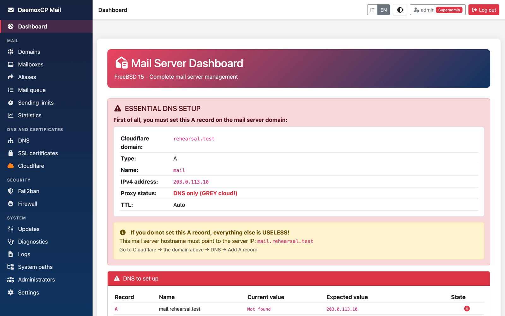
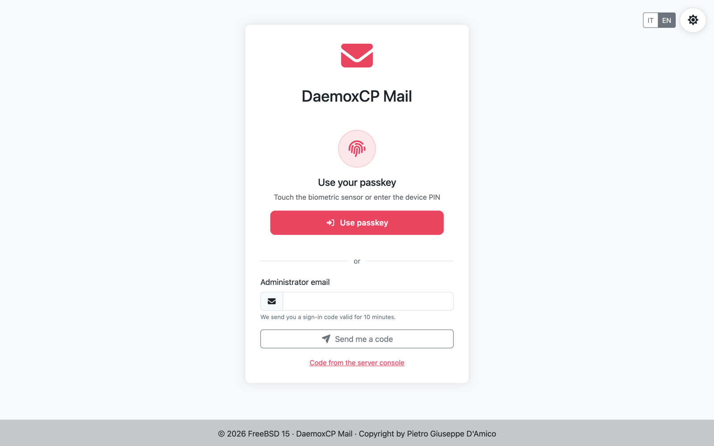
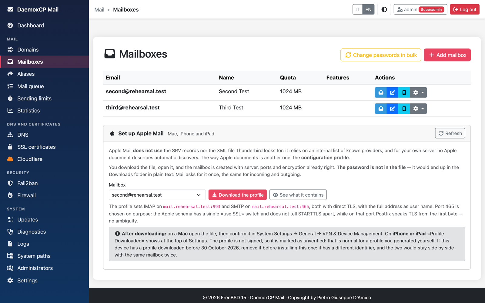
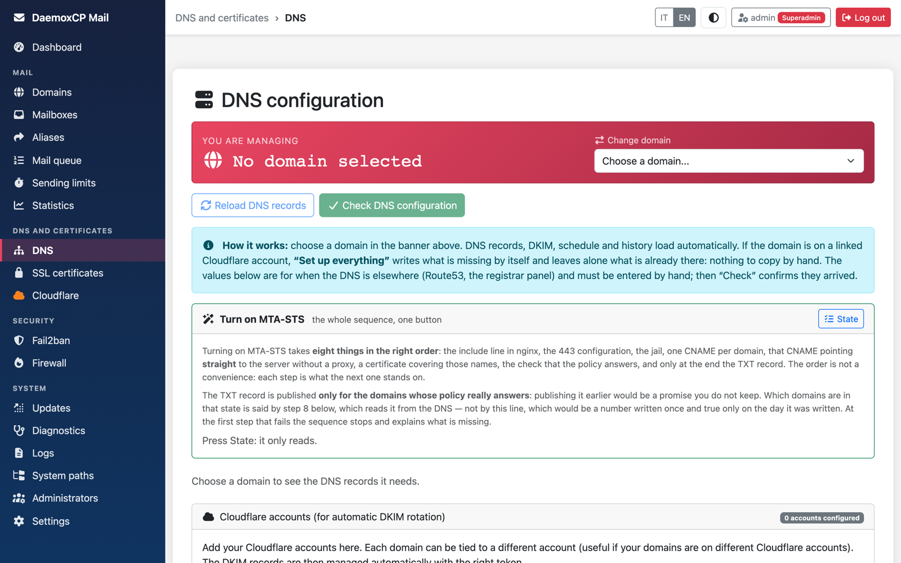
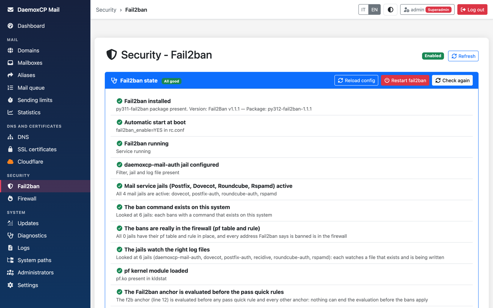
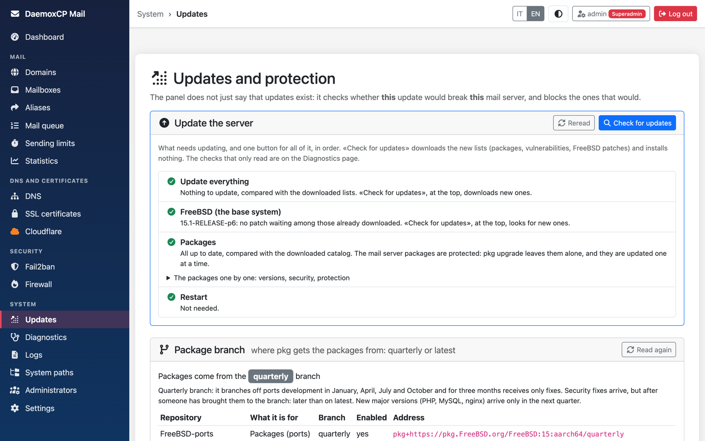
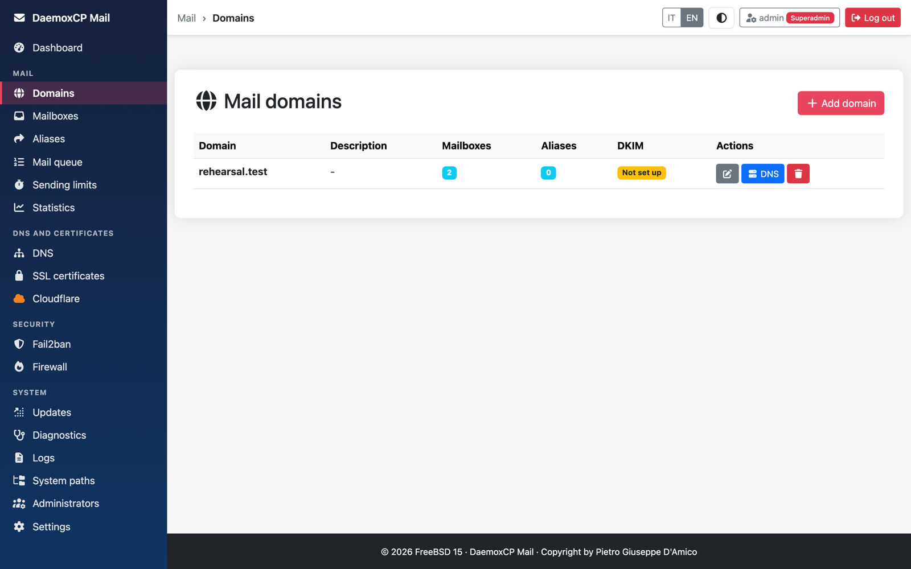
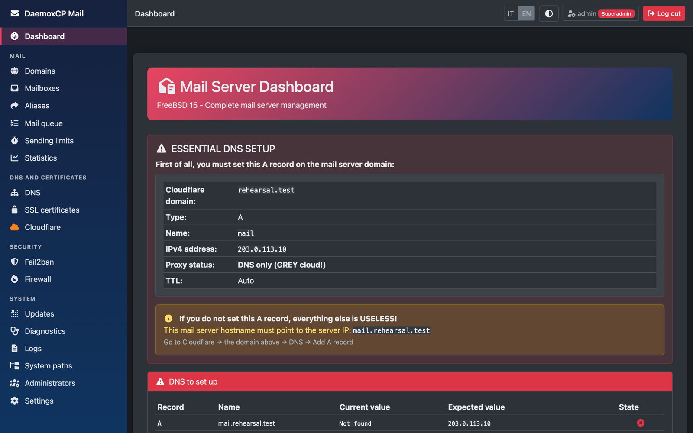
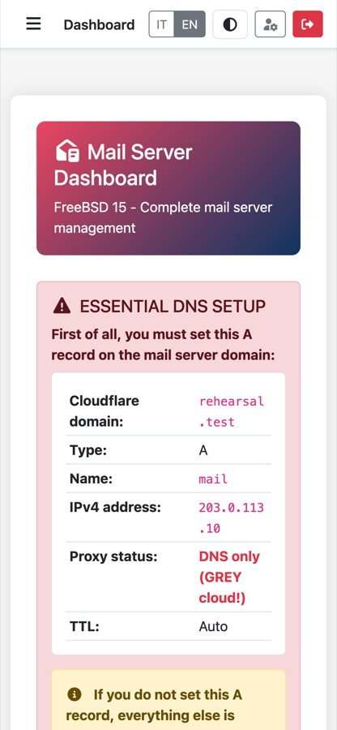

<div align="center">

# 😈 DaemoxCP Mail

**A complete, native mail server and its control panel — for FreeBSD.**

Postfix · Dovecot · Rspamd · ClamAV · Redis · MySQL · Roundcube · nginx · fail2ban · pf

`FreeBSD 15.1+ only` · `amd64 / arm64` · `Java 25` · `AGPL-3.0` · `no Docker, no Linux layer` · `passwordless sign-in`

<a href="https://buymeacoffee.com/pietrogdamico"></a>
<a href="https://www.paypal.com/paypalme/pietrogdamico28"></a>

**English** · [Italiano](README.it.md)



</div>

> [!IMPORTANT]
> **DaemoxCP Mail runs on FreeBSD, and only on FreeBSD 15.1 or later.** It is built around the FreeBSD base
> system: `pkg`, `rc.d`, `pf`, `bectl` and ZFS boot environments, `freebsd-update`, `newsyslog`, `local-unbound`.
> It does not run on Linux, macOS, other BSDs or FreeBSD 14 and earlier, and there is no plan to make it.

---

## Contents

- [What it is](#what-it-is)
- [What it does](#what-it-does)
- [Screenshots](#screenshots)
- [Requirements](#requirements)
- [The mail stack](#the-mail-stack)
- [Security model: who runs as root, and why](#security-model-who-runs-as-root-and-why)
- [Installation](#installation)
- [Daily use](#daily-use)
- [Keeping it up to date](#keeping-it-up-to-date)
- [Coming from FreeBSD Mail Panel](#coming-from-freebsd-mail-panel)
- [Reference](#reference)
- [Troubleshooting](#troubleshooting)
- [Support the project](#support-the-project)
- [Credits and license](#credits-and-license)

---

## What it is

DaemoxCP Mail turns a fresh FreeBSD server into a complete mail server, and then runs it from a web panel. It
installs and configures everything a mail server needs, from the MTA to the webmail, with FreeBSD packages and
FreeBSD's own tools. Then it keeps it in order: DNS records on Cloudflare, certificates, updates that cannot
break the mail, firewall, bans, diagnostics.

It is **native**: no containers, no Linux compatibility layer, no hidden copies of software. Every service is
the FreeBSD package, running under FreeBSD's `rc.d`, with its configuration where FreeBSD expects it
(`/usr/local/etc`). An administrator who knows FreeBSD finds nothing unusual on the machine.

It is **careful**. The panel never changes something it cannot check, and it says why when it refuses:

- every configuration it writes is tested (`postfix check`, `doveconf`, `nginx -t`, `pfctl -nf`,
  `fail2ban-client -t`) before it is used;
- an update of the mail packages is rehearsed before it runs;
- every risky operation keeps a way back, as a ZFS boot environment or a copy of the file.

---

## What it does

**Mail**
- Domains, mailboxes, aliases and forwarding, address transforms.
- Catch-all addresses, from the *Aliases* page. A domain's catch-all takes the mail of every address that is not an
  alias or a mailbox that receives, so mailboxes and aliases keep theirs. Spam sent to invented addresses
  arrives there too, and so does the mail of a mailbox that is turned off or does not receive.
- Mailbox passwords as BLF-CRYPT hashes, and an encrypted copy the administrator can reveal. The copy is
  encrypted with a public key, and only the root part of the panel can read it.
- Users change their password from the webmail (*Settings* → *Password*), with the current one. The change goes
  through the panel, which checks it and writes the hash and the encrypted copy together. The panel turns
  Roundcube's `password` plugin on by itself.

- Mailbox quotas, applied by Dovecot 2.4. Before accepting a message Postfix asks Dovecot: a full mailbox answers
  `452 4.2.2`, so the sender keeps it and retries for a few days, and nothing is lost if space is freed meanwhile. The
  *Mailboxes* page shows how much each mailbox uses. With Dovecot 2.3 they are not applied, and the page says so: the
  *Updates* page moves the server to 2.4.
- Sieve filters and vacation replies, compiled and checked server side.
- A mail queue you can inspect and act on; the maximum message size.
- Sending limits per mailbox: messages per hour, per day and recipients per message, global or for one mailbox.
  Before each message a mailbox sends after signing in, Postfix asks the panel. Each recipient counts as one message.
  Over a limit the sender gets a temporary refusal (`450 4.7.1`) that says why. Incoming mail is not counted, and with
  the panel stopped mail passes.
- Statistics: mail sent and received per day and per domain, spam and viruses Rspamd refused, bounces. The panel
  counts them from Postfix's log every minute (days in UTC, only its own mailboxes, kept 400 days); spam training
  and Rspamd's own figures too.
- Optional POP3 (off by default).

**DNS and certificates**
- One button, **Set up everything**, writes the records each domain needs on Cloudflare:
  - DKIM, SPF and DMARC;
  - MTA-STS (policy, TXT record and certificate);
  - Thunderbird autoconfig and the SRV records.

  It never overwrites a record that is already there.
- DKIM keys rotated through the Cloudflare API, with a dedicated, least-privilege token per account.
- Let's Encrypt certificates through `acme.sh` (the FreeBSD package, running as its own `acme` user), with the
  DNS challenge on Cloudflare.
- Apple Mail configuration profiles (Mac, iPhone, iPad) and Thunderbird autoconfig: clients set themselves up.
  Tested with Apple Mail on macOS on the real server: the profile sets up the account, and mail is sent and
  received. iPhone, iPad and Thunderbird have not been tried with a real client yet.

**Security**
- Sign-in without passwords: **passkeys** (WebAuthn), one-time codes by email, or a code from the server
  console.
- Sensitive operations (settings, keys, the vault) ask for a fresh confirmation, valid 5 minutes: the passkey, a
  code by email, or a code from the server console (`--access-code`), so an administrator without a passkey on a
  server that cannot send mail yet is never stuck.
- Administrators with roles and an audit log of every action.
- **fail2ban** jails for Postfix, Dovecot, Roundcube, Rspamd and the panel itself, with permanent bans and a
  recidive jail.
- **pf** firewall:
  - a default-deny policy;
  - blocking by country, over IPv4 and IPv6;
  - a card that keeps your provider's firewall in step with Cloudflare's address list.
- **IPv4, IPv6 or both**: one choice in *Settings* that Postfix, Dovecot, the webmail, the 443 surface and pf
  follow; SSH never changes. Before anything changes the panel checks that the server has an address and a
  default route in the family that stays, and says what would stop working: DNS records, Cloudflare, mail with
  servers that have only IPv4, your own connection to the panel. Until you choose, nothing is touched.
- **The server's addresses, with a guide both ways** (*Settings*, *Server addresses*): what the server has (address,
  route, whether it really reaches the internet, the mail name's A/AAAA records, the reverse DNS of each family) and
  the steps to get to IPv4 and IPv6, IPv4 only or IPv6 only, and back. IPv6 is added only if the provider gave one
  (on Hetzner the panel reads it by itself), live and without touching IPv4, and kept only if a real check shows the
  server reaching the internet over it; otherwise everything goes back as it was. Mail moves to IPv6 only with the
  IPv6 reverse DNS in place (Gmail and Microsoft require it). The panel never removes a working IPv4: your provider
  does (on Hetzner with the server off), then the panel cleans up what is left. A family you are using to reach the
  panel is never removed, and SSH is never touched.
  With IPv4 and IPv6, a switch says whether mail also comes in over IPv6. Off (recommended): mail goes out over IPv6
  but comes in only over IPv4, where spam and attacks are filtered better. One name for everything, the mail name,
  with its AAAA and its IPv6 reverse DNS: whoever tries to deliver over IPv6 gets an immediate refusal from the
  server's firewall and delivers over IPv4, with no delay. The services' configurations are written once and work for
  every choice (they listen over IPv4 and IPv6); the firewall decides, the panel's own rules too (allowed and blocked
  addresses, countries): the closed family is refused before them. Changing the switch touches neither the DNS nor
  the services.
- Privilege separation: the part that answers on the network runs as an unprivileged user (see
  [Security model](#security-model-who-runs-as-root-and-why)).

**System**
- **Updates** for FreeBSD (`freebsd-update`) and the packages (`pkg`):
  - the mail packages are locked, so that `pkg upgrade` cannot break them;
  - the panel updates them one at a time, with checks, and only on a branch you choose
    (`quarterly` or `latest`).
- **Diagnostics**: *Check everything* reads the whole server and lists what needs a look first, each with its
  next step. Among the checks:
  - outgoing port 25;
  - the reverse DNS;
  - every service and every certificate;
  - Cloudflare's address list.
- Logs, system paths, service users, scheduled restarts, periodic reports by email.
- Interface in **English and Italian** (another language is one more file: see [Languages](#languages)), light and
  dark theme, usable from a phone.

---

## Screenshots

<table>
<tr>
<td width="50%"><br><sub>Sign-in: a passkey, a code by email, or a code from the server console. No passwords.</sub></td>
<td width="50%"><br><sub>Mailboxes, with the Apple Mail configuration profile.</sub></td>
</tr>
<tr>
<td><br><sub>DNS: one button writes the records on Cloudflare; MTA-STS in the right order.</sub></td>
<td><br><sub>Fail2ban: the jails, the logs they read, and the bans really in pf.</sub></td>
</tr>
<tr>
<td><br><sub>Updates: FreeBSD, packages and restart, in order, with protection.</sub></td>
<td><br><sub>Domains, with their mailboxes, aliases and DKIM state.</sub></td>
</tr>
<tr>
<td><br><sub>Dark theme.</sub></td>
<td align="center"><br><sub>On a phone.</sub></td>
</tr>
</table>

<sub>Screenshots from a test server with test domains (`*.test`). The addresses are the ones reserved for
documentation (`203.0.113.0/24`, `2001:db8::/32`).</sub>

---

## Requirements

| What | Needed |
|---|---|
| Operating system | **FreeBSD 15.1-RELEASE or later**, amd64 or arm64. Nothing else. FreeBSD 15.0 reached its end of life on 30 September 2026 and no longer gets security fixes. |
| File system | **ZFS**, for boot environments: the installation, updates and the panel's own upgrades keep a way back with `bectl`. |
| Memory | **4 GB of RAM**. Measured on a running server: ClamAV 1–1.3 GB, the panel's two Java processes about 0.5 GB, MySQL 0.1–0.5 GB; 2.5–3 GB in all. |
| Disk | at least 20 GB, plus the mail. |
| Network | a public IPv4 address, a public IPv6 one, or both (with IPv6 only, mail to and from the many servers that still have only IPv4 does not get through), with a reverse DNS you can set, and outgoing port 25 open (many providers close it on new accounts). |
| Access | root over SSH with a key. **The panel never touches the SSH configuration.** |
| DNS | your mail domains on **Cloudflare**, and an API token limited to their zones. |
| Java | OpenJDK 25 (`pkg install openjdk25`). |
| Names | three host names: one for mail, one for the webmail, one for the panel ([details](#what-you-need-before-you-start)). |

---

## The mail stack

All from FreeBSD packages, configured by the panel, started by `rc.d`.

| Component | Role | Listens on |
|---|---|---|
| **Postfix** | SMTP: receives mail (25), takes it from your clients (465 TLS, 587 STARTTLS), sends it out | 25, 465, 587 |
| **Dovecot 2.4** | IMAP (143, 993), optional POP3 (110, 995), LMTP delivery, Sieve and ManageSieve | 143, 993, 4190 (local only) |
| **Rspamd** | spam filtering, DKIM signing, greylisting, as a Postfix milter | 127.0.0.1:11332–11334 |
| **ClamAV** | antivirus, through Rspamd | Unix socket |
| **Redis** | Rspamd's cache and statistics | Unix socket |
| **MySQL 8.4** | domains, mailboxes, aliases, the panel's data | 127.0.0.1:3306 |
| **nginx + PHP-FPM** | Roundcube webmail on 8443, MTA-STS policy on 443 | 8443, 443, 80 |
| **Roundcube** | webmail, with single sign-on from the panel | (behind nginx) |
| **local-unbound** | the server's own DNS resolver, recursive, so DNSBL lookups work | 127.0.0.1:53 |
| **fail2ban** | bans from the mail and panel logs, into pf | — |
| **pf** | the firewall | — |
| **DaemoxCP Mail** | the panel | 2096 |

---

## Security model: who runs as root, and why

Nothing runs as root unless it has to, and where root stays the panel says why, on the *Updates* page,
under the service users.

### The processes

Measured on a running server (`ps -ax -o user,command`):

| Service | Process | User | Why |
|---|---|---|---|
| **DaemoxCP Mail** | root part (`--web`) | `root` | It manages the machine: packages, services, firewall, configurations, boot environments. **It opens no port**: it only answers the web part on a local socket. |
| | web part (`--web-part`) | `daemoxcp_mail` | Everything that answers on the network (port 2096). It forwards what needs root to the root part on `/var/run/daemoxcp-mail/root.sock`. |
| **Postfix** | `master` | `root` | Opens the mail ports and delivers system mail. |
| | `smtpd`, `qmgr`, `pickup`, … | `postfix` | Everything that talks to the Internet. |
| **Dovecot** | main process, `config`, `log`, `anvil` | `root` | Opens the IMAP/POP3 ports, starts each login and each mailbox with the right user; with Dovecot 2.4 `anvil` must reach every session's process to count and close connections. |
| | `auth` | `dovecot` | Looks up passwords. |
| | logins | `dovenull` | Unauthenticated network side. |
| | IMAP, LMTP, mailboxes | `vmail` | The mail itself. |
| **nginx** | master | `root` | Opens the web ports and reads the TLS keys. |
| | workers | `www` | Serve the requests. |
| **PHP-FPM** | master | `root` | Runs no pages: creates the webmail's socket owned by `roundcube`, group `www`. |
| | `roundcube` pool | `roundcube` | Roundcube's pages. |
| **fail2ban** | server | `root` | Controls pf (`/dev/pf` is root only) and reads the mail logs. |
| **Rspamd** | all processes | `rspamd` | |
| **ClamAV** | `clamd`, `freshclam` | `clamav` | |
| **Redis** | `redis-server` | `redis` | |
| **MySQL** | `mysqld` | `mysql` | |
| **local-unbound** | resolver | `unbound` | |
| **Sieve compiler** | `sievec`, on demand | `sievec` | Compiles users' filters without root. |
| **acme.sh** | renewals | `acme` | Certificates, without root. |

### Files and permissions

| Path | Mode | Owner | What |
|---|---|---|---|
| `/usr/local/etc/daemoxcp-mail/` | `0750` | `root:daemoxcp_mail` | the panel's secrets |
| `…/root-secrets.properties` | `0600` | `root:wheel` | root part's secrets: MySQL administrative access, the private key of the password vault |
| `…/panel-secrets.properties` | `0640` | `root:daemoxcp_mail` | web part's secrets, **read-only** for it: encryption keys, its MySQL password, the vault's public key |
| `…/firewall.json` | `0600` | `root:wheel` | the firewall state |
| `/home/panel/` | `0755` | `root:wheel` | the panel's folder |
| `/home/panel/daemoxcp-mail.jar` | `0644` | `root:wheel` | the program: the web part can read it, nobody but root can change it |
| `/home/panel/database/` | `0750` | `root:daemoxcp_mail` | the panel's configuration (SQLite) |
| `/var/run/daemoxcp-mail/root.sock` | `0660` | `root:daemoxcp_mail` | the channel between the two parts |
| `/var/db/daemoxcp-mail/` | `0755` | `root:wheel` | the panel's state, logs, public MTA-STS files |
| `/var/log/daemoxcp-mail-auth.log` | `0640` | `daemoxcp_mail:wheel` | sign-ins, read by fail2ban |
| `/var/vmail/` | `0770` | `vmail:vmail` | the mailboxes (Maildir) |
| `/usr/local/etc/postfix/mysql-*.cf` | `0640` | `root:postfix` | Postfix's MySQL lookups |
| `/usr/local/etc/dovecot/conf.d/auth-sql.conf.ext` | `0600` | `root:dovecot` | Dovecot's MySQL lookup |
| `/usr/local/www/roundcube/config/config.inc.php` | `0640` | `root:roundcube` | Roundcube's configuration |
| `/var/run/php-fpm-roundcube.sock` | `0660` | `roundcube:www` | only nginx and Roundcube can use it |
| `/var/run/redis/redis.sock` | `0770` | `redis:redis` | Redis, for Rspamd only |
| `/usr/local/etc/ssl/mail/privkey.pem` | `0600` | `root:wheel` | the mail certificate's key |

### MySQL users

Each user can do exactly its job, and no more.

| User | Can |
|---|---|
| `daemoxcp_mail` | the root part of the panel: the `daemoxcp_mail` database. |
| `daemoxcp_mail_web` | the web part: **only `EXECUTE`** on a fixed set of stored procedures. It cannot read or write a table directly. |
| `daemoxcp_mail_routines` | owner of those procedures; **locked** (`ACCOUNT LOCK`), with a password written nowhere. |
| `daemoxcp_mail_postfix` | Postfix: `SELECT` on the few columns its maps read (domains, mailboxes, aliases). |
| `daemoxcp_mail_dovecot` | Dovecot: `SELECT` on the mailbox columns its password query reads. |
| `roundcube` | Roundcube: its own `roundcubemail` database only. |

### Sign-in and data

- **No passwords for administrators.** They sign in with a **passkey** (WebAuthn, user verification
  required), with a **6-digit code** sent by email (valid 10 minutes, 5 attempts, only its HMAC is stored),
  or with an **8-digit code** from the server console.
- **No account enumeration.** Asking for a code gives the same answer whether the address exists or not.
- **Sessions** are kept in MySQL as the SHA-256 of their token. The cookie is `__Host-` prefixed, `Secure`,
  `HttpOnly`, `SameSite=Strict`. A session expires after 30 minutes idle and 12 hours at most, and can be
  revoked. Every request that changes state carries a CSRF token.
- **Administrators' emails** are encrypted with AES-256-GCM and searched through a blind index (HMAC-SHA256).
  The keys are kept outside the database.
- **Mailbox passwords** are stored as BLF-CRYPT hashes, the form Dovecot reads. The copy the administrator can
  reveal is encrypted for each password:
  - a fresh AES-256-GCM key;
  - that key wrapped with RSA-OAEP 3072 in the root part's public key.

  Whoever took over the web part could not read them.
- **The panel's answers** carry a strict Content-Security-Policy (no inline scripts, every asset served by the
  panel itself, no CDN), HSTS, `nosniff`, `frame-ancestors 'none'`.
- The panel answers **only to its own name**: reached by IP address or another name, it answers
  `421 Misdirected Request`.

### Network

- **pf**: default deny on inbound traffic. Open: SSH, the mail ports, and the web ports (behind Cloudflare).
  The panel never writes a rule about SSH and never moves it.
- **Cloudflare**: the panel (2096) and the webmail (8443) are reached through Cloudflare's proxy. The
  *Firewall* page keeps your provider's firewall rule limited to Cloudflare's addresses.
- **fail2ban** reads the panel's own sign-in log, `/var/log/daemoxcp-mail-auth.log`, along with the mail logs.

---

## Installation

The whole installation, from a FreeBSD server that has just been created to a mail server whose panel comes
back by itself after a reboot. Do the steps in this order: each relies on the ones before. The examples use
`example.com`, `203.0.113.10` and `2001:db8::10`: put your own names and addresses in their place.

### What you need before you start

- **A server** with FreeBSD 15.1 or later (amd64 or arm64) on **ZFS**, a public IPv4 address, a public IPv6 one or
  both, **4 GB of RAM** and at least 20 GB of disk.
- **Root access over SSH with a key.**
- **Your domains on Cloudflare** (their DNS is managed by Cloudflare).
- **Three host names**, each with a precise role:

  | Name (example) | What it is | In Cloudflare |
  |---|---|---|
  | `mail.example.com` | the mail server: MX, SMTP, IMAP, the server's reverse DNS | **DNS only** (grey cloud) |
  | `webmail.example.com` | the webmail (Roundcube), on port **8443** | **Proxied** (orange cloud) |
  | `panel.example.com` | this panel, on port **2096** | **Proxied** (orange cloud) |

  The webmail and the panel are two names because each has its own certificate, its own configuration in the
  menu (options 3 and 2) and its own port. They can be in the same domain or in two domains, as long as both
  are on Cloudflare. The mail name must be different from both: mail (25, 465, 587, 993) does not go through
  Cloudflare's proxy, the two web names do. Cloudflare proxies HTTPS on 443, 2053, 2083, 2087, **2096** and
  **8443**: that is why the panel and the webmail use those two ports.

### Step 1 — At your provider (example: Hetzner Cloud)

1. **Reverse DNS.** Set the reverse DNS (PTR) of the server's IPv4 address, and of the IPv6 one if you use it,
   to the mail name (`mail.example.com`). On Hetzner Cloud: the server, *Networking*, the edit button next to
   the address. Big mail providers refuse or mark as spam mail from an address whose reverse DNS does not
   match.
2. **Outgoing ports 25 and 465.** Many providers close them on new accounts. Hetzner Cloud closes both, and
   opens them on request once the first invoice is paid: open a support request saying that the server is a
   mail server. Incoming mail works without this; outgoing mail stays in the queue. The panel checks it for
   you: *Diagnostics*, *Check everything*, "Outgoing mail (port 25)".
3. **The provider's firewall.** Create a firewall with these **inbound** rules and attach it to the server.
   Leave outbound traffic as it is.

   | Rule | Protocol | Ports | Sources |
   |---|---|---|---|
   | SSH | TCP | 22 (or the port your sshd uses) | **only your own IP address**: your IPv4 as `/32` and, if you have one, your IPv6 as `/128` |
   | Mail | TCP | 25, 80, 143, 443, 465, 587, 993 | any IPv4, any IPv6 |
   | POP3, only if you turn it on later in *Settings* | TCP | 110, 995 | any IPv4, any IPv6 |
   | Panel and webmail | TCP | 2096, 8443 | **only Cloudflare's addresses** |

   Cloudflare's addresses are published at <https://www.cloudflare.com/ips-v4> and
   <https://www.cloudflare.com/ips-v6>. Once the panel runs, its *Firewall* page has the card "Your provider's
   firewall" with the list ready to paste and the same rules computed from the server's real ports.

   No other inbound rule is needed: in particular **none for 53 (DNS) and none for 123 (NTP)**. The Hetzner
   Cloud firewall is stateful, so the answers to the server's own queries come back on their own, and an open
   123 would only expose the clock service.

   **Cloudflare's list changes from time to time, and you update it by hand.** Hetzner Cloud tokens are "Read"
   or "Read & Write" on the whole project: a token that can change the firewall can also delete the server,
   and it does not belong on a mail server. When you have put the list in the firewall, press "I have put this
   list in my provider's firewall": when Cloudflare changes its list, the card and *Diagnostics* tell you.

   Other providers: the same rules in their firewall. Hetzner's dedicated servers (Robot) have a firewall that
   is **not** stateful: there you also need the rule that lets in the answers to the server's own connections
   (TCP, ports 32768–65535, with the ACK flag).

### Step 2 — At Cloudflare

1. **DNS records** (in each zone):

   | Type | Name | Content | Proxy status |
   |---|---|---|---|
   | A | `mail` | `203.0.113.10` (the server's IPv4) | **DNS only** |
   | AAAA | `mail` | `2001:db8::10`, if the server has IPv6 | **DNS only** |
   | MX | `@` | `mail.example.com`, priority 10 | — |
   | A | `webmail` | `203.0.113.10` | **Proxied** |
   | A | `panel` | `203.0.113.10` | **Proxied** |

   Repeat the MX record in every domain whose mail this server receives. SPF, DKIM, DMARC, MTA-STS, autoconfig
   and the SRV records are written later by the panel itself (step 7): you do not type them.
2. **SSL/TLS encryption mode: Full (strict).** Cloudflare then talks to the server over HTTPS and checks its
   certificate.
3. **Origin certificates.** *SSL/TLS*, *Origin Server*, *Create Certificate*: key type RSA (2048), the host
   names (for example `panel.example.com` and `webmail.example.com`, or `*.example.com` and `example.com`),
   validity up to 15 years. Cloudflare shows the certificate and the private key once: save them as two files,
   for example `panel-origin.pem` and `panel-origin.key`. An origin certificate covers the names of one zone
   only: if the panel and the webmail are in two domains, create one in each.
4. **An API token for the panel.** *My Profile*, *API Tokens*, *Create Token*, template *Edit zone DNS*, with
   **Zone › DNS › Edit** and **Zone › Zone › Read**, and *Zone Resources* › *Include* › *Specific zone* for
   each mail domain. Never the Global API Key. You enter it in the panel in step 7.

### Step 3 — The base system

Log in as root and bring the system and the package catalog up to date:

```bash
freebsd-update fetch install
```

```bash
pkg update && pkg upgrade
```

The first time `pkg` runs it offers to install itself: answer yes. `freebsd-update` keeps the system as it was
in a boot environment (`bectl list` shows it) and may restart `sshd`: the SSH session you are in stays open.
If it installed a new kernel, reboot (`shutdown -r now`) before going on.

### Step 4 — Java

The panel is a Java 25 program:

```bash
pkg install openjdk25
```

OpenJDK on FreeBSD wants `procfs` mounted on `/proc`. Add it to `/etc/fstab`, so that it is there after every
reboot too, and mount it now if it is not mounted yet (some FreeBSD images already have it):

```bash
grep -q '^proc' /etc/fstab || echo 'proc /proc procfs rw 0 0' >> /etc/fstab
```

```bash
mount | grep -q ' on /proc ' || mount /proc; java -version
```

`java -version` must say `25`.

### Step 5 — The panel and the certificates on the server

1. **Get the panel's jar.** Download `daemoxcp-mail.jar` from the latest
   [release](https://github.com/DaemoxCP/mail/releases) and check that its SHA-256 is the one in the release notes:

   ```bash
   shasum -a 256 daemoxcp-mail.jar
   ```

   (`sha256 -q daemoxcp-mail.jar` on FreeBSD). On a server with **IPv6 only**, GitHub cannot be reached from the
   server (it has no IPv6 yet): download the jar on your computer and copy it with `scp`. Or build it yourself, on
   any computer with Java 25 and Maven, from this repository:

   ```bash
   tools/build-jar.sh
   ```

   It writes `target/daemoxcp-mail.jar` with the build number and the commit inside, and prints the jar's
   SHA-256.
2. **Put it in `/home/panel`**, not in `/root`. The panel's web part runs as its own user, `daemoxcp_mail`,
   which must be able to read the jar; `/root` is closed to other users.

   ```bash
   install -d -m 755 /home/panel
   ```

   Then, from your computer (`target/daemoxcp-mail.jar` if you built it):

   ```bash
   scp daemoxcp-mail.jar root@203.0.113.10:/home/panel/
   ```
3. **Copy the origin certificates.** The panel's pair can go anywhere: the panel reads it once and keeps it.
   The webmail's pair must stay where you put it, because nginx reads it from there: use
   `/usr/local/etc/ssl/webmail/`, never `/usr/local/etc/ssl/mail/`, which the installation empties.

   ```bash
   install -d -m 700 /root/certs /usr/local/etc/ssl/webmail
   ```

   From your computer:

   ```bash
   scp panel-origin.pem panel-origin.key root@203.0.113.10:/root/certs/
   ```

   ```bash
   scp webmail-origin.pem webmail-origin.key root@203.0.113.10:/usr/local/etc/ssl/webmail/
   ```

   On the server, keep the private keys readable by root only:

   ```bash
   chmod 600 /root/certs/*.key /usr/local/etc/ssl/webmail/*.key
   ```

### Step 6 — The terminal menu

Open the menu from the panel's folder, in a terminal of at least 120 × 40 characters (from your computer:
`ssh -t root@203.0.113.10`):

```bash
cd /home/panel && java -jar daemoxcp-mail.jar
```

Arrows to move, Enter to choose, Tab to go from a field to the next. Every option asks for a confirmation
first, with *Cancel* selected: press Tab to reach *OK*. Go through the options in this order:

1. **1) Time zone, clock (NTP) and DNS resolver.** Write the server's time zone as an IANA name (for example
   `Europe/Rome` or `UTC`): names that do not exist are refused. It also turns on NTP.
2. **2) Edit Panel Configuration.**
   - *PANEL PORT*: `2096`;
   - *PANEL HOST*: the panel's name, `panel.example.com` (not an IP address: passkeys and Cloudflare need a
     name);
   - *SSL CERTIFICATE* and *SSL PRIVATE KEY*: `/root/certs/panel-origin.pem` and
     `/root/certs/panel-origin.key` (pasting the PEM text works too).

   Before saving, the panel checks that the certificate is readable, valid now, covers the panel's name and
   that the key is its own, and shows what it covers and when it expires.
3. **3) Edit Roundcube Configuration.** *DOMAIN* `webmail.example.com`, *PORT* `8443`, *SSL CERT PATH* and
   *SSL KEY PATH* `/usr/local/etc/ssl/webmail/webmail-origin.pem` and `…/webmail-origin.key`. Same checks.
4. **4) Install/Reinstall Mail Server.** It asks for the mail name, `mail.example.com`, checks the three names,
   then installs and configures MySQL, Postfix, Dovecot, Rspamd, ClamAV, Redis, nginx, PHP and Roundcube,
   fail2ban and the firewall. It takes several minutes and goes on even if the terminal closes; its log is in
   `/var/log/daemoxcp-mail/`. Before starting it keeps the server as it was in a boot environment.
   **It erases any existing mail configuration, mailboxes and panel accounts**: on a new server there is
   nothing to lose.
5. **5) Emergency access code.** There is no administrator yet: it asks for a name and an email, creates the
   first administrator, and shows an **8-digit code**, valid for 15 minutes.
6. **>>> Start DaemoxCP Mail web server <<<.** The panel starts; leave the terminal open for now.

### Step 7 — The first sign-in, and the panel's own set-up

1. Open `https://panel.example.com:2096`. On the sign-in page choose **Code from the server console** and type
   the 8-digit code.
2. **Passkeys.** In *Account*, register a passkey (fingerprint, face, device PIN or a hardware key), better two
   on two different devices. From now on you sign in with a passkey, or with a 6-digit code sent to your email.
3. **Start at boot.** *Diagnostics*, card *Operating system*, **Start at boot**, then **Install and enable**.
   It writes `/usr/local/etc/rc.d/daemoxcp_mail` and turns it on, without starting a second copy of the panel.
4. Back in the terminal, press **Enter**: the panel started from the menu stops. Start it as a service, the
   way it will run from now on:

   ```bash
   service daemoxcp_mail start
   ```

   ```bash
   service daemoxcp_mail status
   ```

   From now on it starts by itself at every boot. Try it: `shutdown -r now`, and after a minute or two the
   panel answers again.
5. **Cloudflare.** On the *Cloudflare* page add the account with the token of step 2 (**Test token** first),
   then choose it for the mail server's certificate.
6. **Let's Encrypt.** On the *SSL certificates* page, card "Let's Encrypt is not ready": write the email for the
   Let's Encrypt account and press **Install acme.sh**. It installs the FreeBSD package `security/acme.sh`,
   which runs as its own user `acme`, and creates the account.
7. **Domains.** On *Domains*, **Add domain** for each mail domain. Then on *DNS* choose the domain (*Change
   domain*, at the top) and press **Set up everything**: DKIM, SPF, DMARC, autoconfig, the SRV records and
   MTA-STS, with a Let's Encrypt certificate for the mail name and the MTA-STS names. It never overwrites a
   record that is already there. Under the card every step gets a line with its outcome; a FAILED line says
   what it needs.
8. **The provider's firewall.** *Firewall*, card **Your provider's firewall**: check its rules against the ones
   of step 1, put Cloudflare's list in the panel and webmail rule, then press **I have put this list in my
   provider's firewall**.
9. **Check everything.** *Diagnostics*, **Check everything**: what needs a look comes first, each with its next
   step. Then create the mailboxes (*Mailboxes*, **Add mailbox**) and send and receive a test message, for
   example from the webmail.

---

## Daily use

| Page | What you do there |
|---|---|
| **Dashboard** | the state of the server at a glance, and the DNS still to set up |
| **Domains**, **Mailboxes**, **Aliases** | the mail itself, catch-all addresses included; from a mailbox: password, Sieve filters, vacation reply, Apple profile, webmail sign-in |
| **Mail queue** | what is waiting, why, and what to do with it |
| **Sending limits** | messages per hour and per day for each mailbox, recipients per message, the maximum message size |
| **Statistics** | mail sent and received per day and per domain, spam, bounces, and spam training from Rspamd |
| **DNS** | the records of each domain, *Set up everything*, MTA-STS, DKIM rotation |
| **SSL certificates** | Let's Encrypt, the panel's and the webmail's certificates, their expiry |
| **Cloudflare** | accounts and tokens, which zones each one sees |
| **Fail2ban**, **Firewall** | jails and bans, pf policy, countries, your provider's firewall |
| **Updates** | FreeBSD, packages, restarts, the package branch |
| **Diagnostics** | *Check everything*, with the next step for each finding |
| **Logs**, **System paths** | what the services write, and where everything is |
| **Administrators** | who can sign in, with which role; the audit log |
| **Settings**, **Account** | the panel's options, among them IPv4, IPv6 or both; your passkeys and sessions |

---

## Keeping it up to date

- **FreeBSD and the mail software**: the *Updates* page. It says what is new and does every step in order, with
  its checks. The mail packages are locked against a plain `pkg upgrade`, so the panel updates them itself, one
  at a time, after checking that the new version would not break the mail.
- **The panel itself**: build the new jar and run `tools/upgrade/upgrade-panel.sh` on the server (see
  [`tools/upgrade/README.md`](tools/upgrade/README.md)). Before touching anything it:
  - checks the jar's SHA-256;
  - photographs the server's state;
  - keeps a boot environment and a copy of the panel.

  Then it starts the new panel twice and stops at the first sign that something is wrong or different:
  - the first start may only run the new version's migrations;
  - the second must have nothing left to do.

  `rollback-panel.sh` puts everything back without losing the mail.

  When a new version is out, the panel tells you. Once a day it reads the list of releases of
  [DaemoxCP/mail](https://github.com/DaemoxCP/mail/releases) on GitHub. If one is newer than the panel, it says so,
  with the link to the release page:
  - on the *Dashboard*;
  - on the *Updates* page, which also has *Check now*;
  - in the periodic report.

  It downloads and installs nothing: the update stays the step above. The check sends GitHub nothing but the request
  itself (GitHub sees the server's address). It can be turned off on the *Updates* page. A beta panel (0.x) is also
  told about pre-releases; a 1.x panel only about releases.
- **Cloudflare's addresses**: when *Diagnostics* says Cloudflare changed its list, update the panel and webmail
  rule in your provider's firewall and confirm it on the *Firewall* page.

> [!NOTE]
> Installing a release from the panel itself, with the same checks as `upgrade-panel.sh`, is planned.

### The tests

`tests/` holds the panel's tests, one Java class each, plus browser tests with Playwright. They are run by hand on a
FreeBSD test machine before every release: how, in [`tests/README.md`](tests/README.md).

---

## Coming from FreeBSD Mail Panel

DaemoxCP Mail was called *FreeBSD Mail Panel* until 17 November 2026. A server installed with that name moves
to the new one **by itself, at the first start of this version**, with `upgrade-panel.sh` as usual. Every step:

- is tested;
- puts things back as they were if it fails;
- says what it did in the log.

A second start has nothing to do.

| What | Before | Now |
|---|---|---|
| service | `service mailpanel …` | `service daemoxcp_mail …` |
| jar | `freebsd-mail-panel-1.0.jar` | `daemoxcp-mail.jar` |
| web part's user and group | `mailpanel` | `daemoxcp_mail` (same uid and gid) |
| secrets | `/usr/local/etc/mail-panel/` | `/usr/local/etc/daemoxcp-mail/` |
| data | `/var/db/mailpanel/`, `/var/db/mail-panel/` | `/var/db/daemoxcp-mail/` |
| MySQL database | `mailserver` | `daemoxcp_mail` |
| MySQL users | `mailpanel`, `mailpanel_web`, `mailpanel_routines`, `mailpanel_postfix`, `mailpanel_dovecot` | `daemoxcp_mail`, `daemoxcp_mail_web`, `daemoxcp_mail_routines`, `daemoxcp_mail_postfix`, `daemoxcp_mail_dovecot` |
| fail2ban jails | `mail-panel-auth`, `mailpanel-public` | `daemoxcp-mail-auth`, `daemoxcp-mail-public` (bans carried over) |
| sign-in log | `/var/log/mail-panel-auth.log` | `/var/log/daemoxcp-mail-auth.log` |
| Roundcube plugin | `mailpanel_sso` | `daemoxcp_mail_sso` |
| package lock mark | `mail_panel_lock` | `daemoxcp_mail_lock` |

Postfix maps, Dovecot's SQL, Roundcube's configuration, the nginx and pf files and the comments the panel wrote
in the services' files are updated along the way, and each service is checked and reloaded.

---

## Reference

### Commands

| Command (from `/home/panel`) | What it does |
|---|---|
| `java -jar daemoxcp-mail.jar` | the terminal menu; the web server starts from its last entry |
| `java -jar daemoxcp-mail.jar --web` | only the web server, no menu (what the service runs) |
| `java -jar daemoxcp-mail.jar --access-code [name]` | a one-time 8-digit sign-in code for an administrator |
| `java -jar daemoxcp-mail.jar --create-admin <name> <email>` | the first administrator, when there is none |
| `java -jar daemoxcp-mail.jar --ip-family both\|ipv4\|ipv6\|ipv6out` | IPv4, IPv6, both, or both with mail over IPv6 only going out, as in *Settings*, as root: the way back when a choice cut you off from the panel |
| `java -jar daemoxcp-mail.jar --addresses show\|ipv6-off\|ipv4-dhcp` | the server's addresses, as root: show them, remove the IPv6 the panel added (the previous `rc.conf` lines come back), or take IPv4 again by DHCP |
| `service daemoxcp_mail start\|stop\|restart\|status` | the panel as a service |

The console commands must run from `/home/panel`: the panel's database is in `database/` next to the jar.

From 0.9.0 the jar is called `daemoxcp-mail.jar`, without the version (the version is inside it, and on the
dashboard). On servers installed before, the file is still `daemoxcp-mail-1.0.jar` and the service keeps using it:
at its first start the panel adds `daemoxcp-mail.jar` next to it as a link, so the commands above are the same
everywhere, and `tools/upgrade/upgrade-panel.sh`, which replaces the real file, never leaves the link behind.

### The terminal menu

```
╔═══════════════════════════════════════════════════════════════╗
║             DaemoxCP Mail - Select an option                  ║
╠═══════════════════════════════════════════════════════════════╣
║  1) Time zone, clock (NTP) and DNS resolver                   ║
║  2) Edit Panel Configuration                                  ║
║  3) Edit Roundcube Configuration                              ║
║  4) Install/Reinstall Mail Server                             ║
║  5) Emergency access code                                     ║
║  6) Go back to the server before the last reinstallation      ║
║  >>> Start DaemoxCP Mail web server <<<                       ║
║  Exit                                                         ║
╚═══════════════════════════════════════════════════════════════╝
```

Option 6 brings back the boot environment taken before the last installation, and reboots after asking.

### Where things are

| Path | What |
|---|---|
| `/home/panel/` | the jar, `database/` (the panel's configuration), `install_scripts/` |
| `/usr/local/etc/daemoxcp-mail/` | the panel's secrets |
| `/var/db/daemoxcp-mail/` | the panel's state: its log `panel.log`, jobs, reports, locked packages, public MTA-STS files |
| `/var/log/daemoxcp-mail/` | installation logs |
| `/var/log/daemoxcp-mail-auth.log` | sign-ins, for fail2ban |
| `/usr/local/etc/rc.d/daemoxcp_mail` | the service |
| `/usr/local/etc/postfix/`, `/usr/local/etc/dovecot/`, `/usr/local/etc/rspamd/` | the mail services, as FreeBSD expects |
| `/usr/local/www/roundcube/` | the webmail |
| `/var/vmail/<domain>/<user>/` | the mailboxes |

### Ports

| Port | Service | Open to |
|---|---|---|
| 22 | SSH (never touched by the panel) | your own address |
| 25 | SMTP | everyone |
| 465, 587 | SMTP submission (TLS, STARTTLS) | everyone |
| 143, 993 | IMAP (STARTTLS, TLS) | everyone |
| 110, 995 | POP3, only if turned on | everyone |
| 80, 443 | certificates, MTA-STS | everyone |
| 2096 | the panel | Cloudflare only |
| 8443 | the webmail | Cloudflare only |
| 3306, 11332–11334, 53 | MySQL, Rspamd, the resolver | the server itself |

### Languages

The panel speaks English and Italian. It uses, in this order:

1. the language chosen with the switch in the top bar, saved with the account (it follows you on every browser);
2. the one chosen before signing in;
3. the browser's preferred language, among the panel's;
4. English.

Every text of the interface is in `src/main/resources/lang/`, one file per language named with its ISO 639-1 code
(`it.json`, `en.json`): flat keys, no text in the pages or in the code. A new language is a new file, and its code
in one list:

1. Copy `en.json` to the new code, for example `es.json`, and translate the values. Leave the keys and the
   `{values}` in braces as they are. The `.html` texts may use only `<strong>`, `<em>`, `<code>`, `<kbd>` and
   `<br>`.
2. Plural forms. A counted text has `key.one` and `key.other`. A language with more forms adds the ones CLDR
   gives it (`key.few`, `key.many`…). The panel picks the form with the CLDR rules: `I18n.pluralCategory` on
   the server, `Intl.PluralRules` in the browser. A language missing from `I18n.PLURAL_RULES` needs its rule
   written there first.
3. Add the code to the list in the database procedure `set_admin_language` (`SqlCatalog.java`): the database
   saves only the panel's languages. The procedure is updated by itself at the next start.
4. Rebuild the jar (`tools/build-jar.sh`) and run `I18nTest` and `layout-browser-test.js`
   ([tests/README.md](tests/README.md)). They refuse a key Italian does not have, a missing `{value}`, a plural
   form the language does not have, and a language missing from the procedure's list.

At the next start the language is in the switch, written in its own language (*Español*, *Français*). With three
or more languages the two buttons become a menu. The file may be partial: a missing text is shown in English,
then in Italian. The dates in the pages follow the language.

> [!NOTE]
> Right-to-left languages (Arabic, Hebrew, Persian…) need a frame that does not exist yet: `dir="rtl"`,
> Bootstrap's RTL build and mirrored icons. The tests refuse them until then.

---

## Troubleshooting

Start from **Diagnostics › Check everything**: it reads the whole server and says what is wrong and what to do
next, in order of importance. Then:

| Symptom | Look at |
|---|---|
| mail does not go out | *Diagnostics*, "Outgoing mail (port 25)": most often the provider still blocks port 25; then the reverse DNS |
| mail does not arrive | the MX record, the *Mail queue*, `/var/log/maillog` |
| a client cannot sign in | *Fail2ban*: the address may be banned; the mailbox may be disabled |
| the panel does not answer | `service daemoxcp_mail status`, then `/var/db/daemoxcp-mail/panel.log` |
| `421 Misdirected Request` | the panel was reached by IP or by another name: use its own name |
| no administrator can sign in | `java -jar daemoxcp-mail.jar --access-code` from `/home/panel` |
| the panel stopped answering after choosing IPv4 only or IPv6 only | as root, from `/home/panel`: `java -jar daemoxcp-mail.jar --ip-family both` |
| the panel stopped answering after a step of *Server addresses* | as root, from `/home/panel`: `java -jar daemoxcp-mail.jar --addresses show`, then `--addresses ipv6-off` or `--addresses ipv4-dhcp`; your provider's web console works even without network |

---

## Support the project

DaemoxCP Mail is free software, with no ads and no paid tier. Donations pay for the FreeBSD servers and test machines it is
built and tested on, and for the time to keep it careful.

- [Buy me a coffee](https://buymeacoffee.com/pietrogdamico)
- [PayPal](https://www.paypal.com/paypalme/pietrogdamico28)

Either way, a star helps the next person trust it. **Bugs and requests** go in this repository's
[Issues](../../issues).

---

## Credits and license

**Created by Pietro Giuseppe D'Amico.**

Copyright © 2025–2026 Pietro Giuseppe D'Amico.

DaemoxCP Mail is free software, licensed under the **GNU Affero General Public License, version 3 only**
([LICENSE](LICENSE)). You may use, study, modify and share it. If you distribute a modified version, or let others
use it over a network, you must give them its source under the same license, with this copyright notice.

FreeBSD is a registered trademark of The FreeBSD Foundation; DaemoxCP is not affiliated with or endorsed by it.
The 😈 is a plain emoji, used as a nod to the BSD Daemon: the official BSD Daemon artwork is
© Marshall Kirk McKusick and is not included here. All the other software DaemoxCP Mail installs belongs to
its authors, under its own license.
